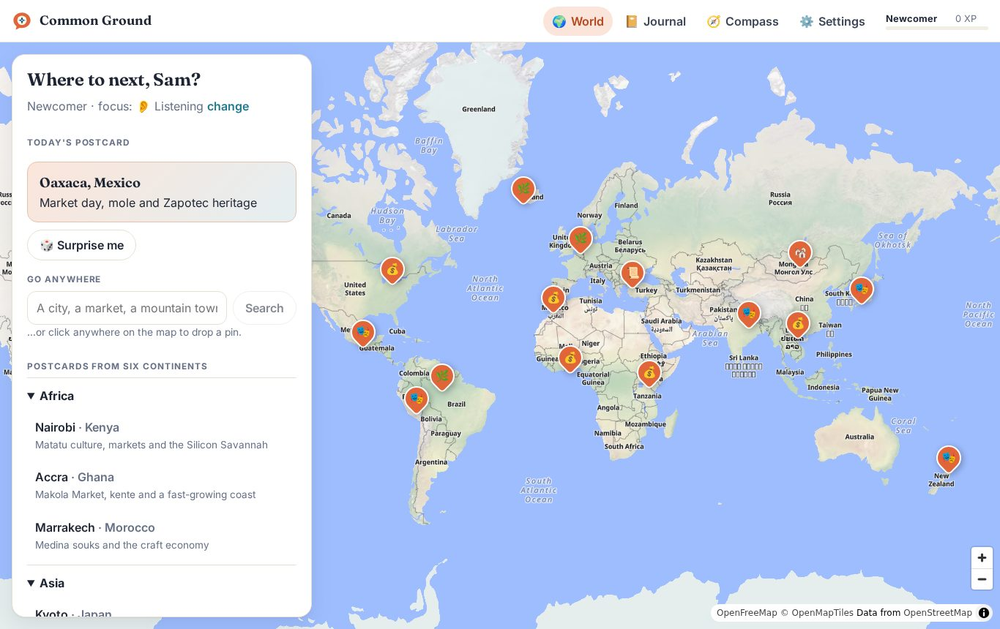
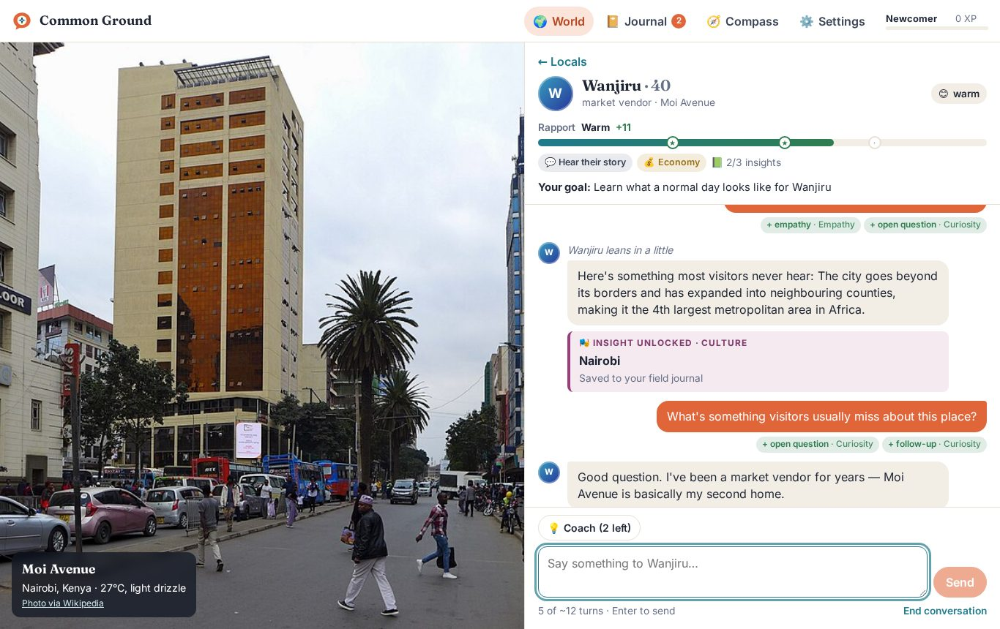
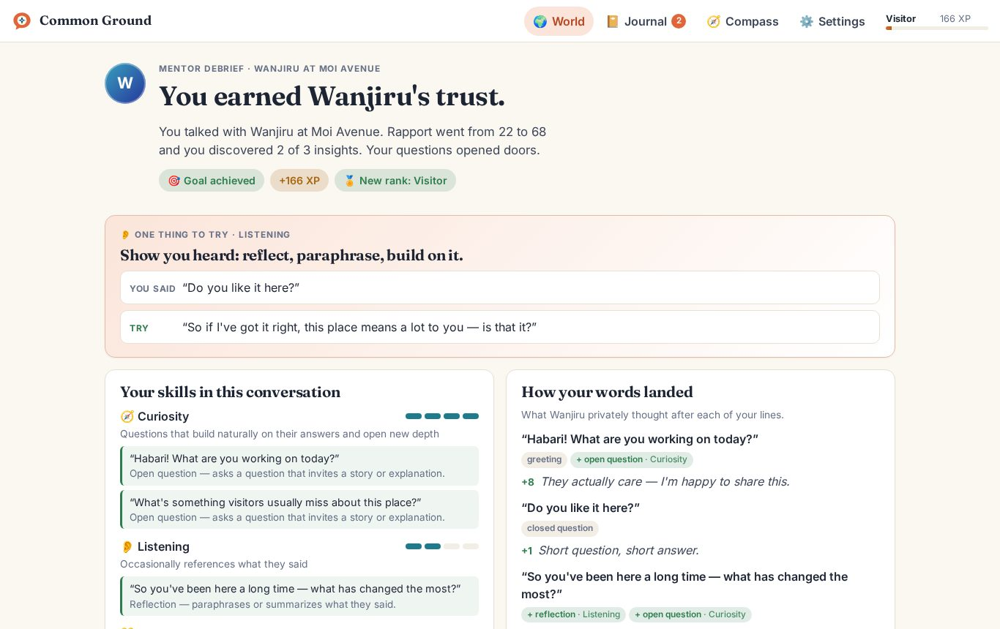

# Common Ground

[](https://github.com/sloth-os/life/actions/workflows/ci.yml)

> *Explore the real world. Meet its people. Find common ground.*

**Common Ground** is a web game built around AI. You travel anywhere on Earth through **Google Maps**, meet **AI locals grounded in real places**, and earn their trust with real social skills. Each conversation ends with a **mentor debrief** that quotes your own words: what worked, one thing to try, and a rewrite of a line you actually said. As locals come to trust you, they share **insights about the place's nature, culture, history, society and economy**, each linked to its source. Those insights become cards in your field journal, which you review with spaced repetition.

| World map | A conversation | Mentor debrief |
|---|---|---|
|  |  |  |

*(Screenshots are from Demo AI + Open map mode. With API keys you get locals played by Claude or any OpenAI-compatible model, Google Maps and Street View.)*

Also in the game:
- **Voice mode.** Speak to locals: a voice model hears what you said and *how* you said it (tone, pace, clarity). The local reacts to it, and your mentor can comment on your delivery. You can also practise a local greeting and get a pronunciation score.
- **Two locals at odds.** A mediation challenge on every expedition: two people disagree, and you help them find common ground.
- **Ask your mentor.** Follow-up questions about your debrief, answered from your own conversation.
- **Postcards.** A painted souvenir of each place, collected in your atlas.
- **Classroom mode.** Teachers assign expeditions with a focus skill and see a class debrief. Students share summaries, never their conversations. Several server instances can share one class list through Postgres.
- **Six languages.** English, Spanish, Simplified Chinese, French, Brazilian Portuguese and Japanese, for the interface and for everything the AI writes.
- **3D fly-ins** over Google's photorealistic map while an expedition is prepared.
- **Server settings in the browser.** Everything the server is configured with (the AI, voice, postcards, maps, classes, access) can be set on a settings page behind a key. Changes apply at once, without a restart.

## Why it works

The design is based on research about how people learn conversation skills. In brief (details and citations in [`docs/DESIGN.md`](docs/DESIGN.md)):

- **AI Partner + AI Mentor**: separate agents play the local and coach you (Yang et al., 2024).
- **Feedback is what builds skill.** In a randomized trial, practice alone mostly raised confidence; skill gains needed feedback (CARE, Louie et al., 2025). So every encounter ends in a debrief with **verbatim evidence**, which the server checks.
- **Realistic, principled partners.** Locals follow a written constitution (Roleplay-doh; Rehearsal): their rapport is earned, they disclose more only as trust grows, they have boundaries and their own agenda, and they don't flatter you (social sycophancy research).
- **People, not stereotypes.** Prompts follow a persona charter to counter the exoticizing patterns that LLM-written personas fall into (Marked Personas, ACL 2023).
- **Experiential learning loop.** You reflect first, then get feedback, then a concept card, then a **real-world field mission** (Kolb; deliberate practice). Insights become **spaced-recall** cards.

The **Skill Compass** tracks six skills: 🧭 Curiosity · 👂 Listening · 💛 Empathy · 🙏 Respect · 🔆 Clarity · 🤝 Common Ground.

## Quick start

Requires **Node.js 22.18+**; the server runs TypeScript natively.

```bash
npm install
npm run dev          # http://localhost:8787
```

It runs with **no keys at all**, in Demo AI + Open map mode: scripted locals built from real Wikipedia and Open-Meteo data, drawn on an OpenStreetMap-based map. Add keys to unlock the full experience, in either of two ways:

- **On the settings page.** Open `http://localhost:8787/#settings` (or Settings → Server in the game) and enter the settings key. The server prints the key once, the first time it starts; `ADMIN_KEY` sets your own, and `node scripts/settings-key.ts` makes a new one if it's lost. Each section has a **Test** button that checks the service with the values in the form before you save. Saving applies the change at once: the server rebuilds only what the change touches, conversations in progress carry on, and open browsers pick up the new configuration within a minute.
- **In the environment**, or a `.env` file. Edits to `.env` apply without a restart too.

```bash
cp .env.example .env   # then fill in what you have
```

A value set on the page overrides the environment's until you reset it there. The page never shows a secret back: API keys stay on the server and the page shows only their last characters.

| Variable | What it enables |
|---|---|
| `ANTHROPIC_API_KEY` | **Claude** plays the Game Master, the locals and the mentor (default model `claude-opus-5-5`; override with `CLAUDE_MODEL`) |
| `AI_PROVIDER=openai`, `AI_MODEL`, `AI_BASE_URL`, `AI_API_KEY` | Any **OpenAI-compatible** model instead, through the OpenAI SDK: OpenAI, a gateway, vLLM, Ollama… (`OPENAI_API_KEY`, `OPENAI_BASE_URL` and `OPENAI_MODEL` work too). The `AI_*` variables also configure Claude with `AI_PROVIDER=anthropic`. |
| `GOOGLE_MAPS_API_KEY` | **Google Maps** in the browser: the interactive map, Advanced Markers and **Street View** at each local's spot. Enable the *Maps JavaScript API* and restrict the key by HTTP referrer. |
| `GOOGLE_MAPS_MAP_ID` | Your Map ID (defaults to `DEMO_MAP_ID` for testing) |
| `GOOGLE_MAPS_SERVER_KEY` | **Maps Experience agent tools** (MCP, `mapstools.googleapis.com`): grounds the AI in real Google Maps places and live weather, and powers "Go anywhere" search. Enable that API and restrict the key by API, not referrer. |
| `MAPS_MODE` | `auto` (default) uses Google Maps when `GOOGLE_MAPS_API_KEY` is set; `open` always uses the open map |
| `ACCESS_CODE` | Optional passcode for classroom or public deployments |
| `RATE_LIMIT_PER_10MIN`, `TRUST_PROXY` | AI requests per player per 10 minutes (default 120; a shared classroom IP gets 10×). Set `TRUST_PROXY=true` behind a proxy. |
| `APP_USER_AGENT` | Contact string sent to Wikipedia, Nominatim and Open-Meteo, as their usage policies ask. Please set it. |
| `EFFORT_TURN`, `EFFORT_DEBRIEF`, … | Effort per task (defaults: `low` for turns, hints and mentor answers, `medium` for the rest) |
| `AI_MAX_TOKENS_TURN`, `AI_MAX_TOKENS_PERSONA`, … | Output cap per task on OpenAI-compatible servers, in tokens (defaults from 600 for hints to 6000 for expeditions; `0` for none). A task that thinks gets 16,000 more for its reasoning. An answer cut off at the cap is asked for once more, briefly. |
| `OPENAI_JSON_MODE` | Structured output to try first with OpenAI-compatible servers: `json_schema` (default), `json_object` or `text`. The game steps down automatically when a server rejects one. |
| `AI_THINKING`, `AI_THINKING_STYLE` | Reasoning for OpenAI-compatible models: `auto` (default) thinks only for tasks whose effort is `high` or above; `off` never thinks; `model` leaves it to the model. The style (`qwen`'s `enable_thinking` or `openai`'s `reasoning_effort`) is read from the model name unless set. A switch the server rejects is dropped. |
| `AI_MODEL_EXPEDITION`, `AI_MODEL_PERSONA`, `AI_MODEL_SCENE`, `AI_MODEL_TURN`, `AI_MODEL_HINT`, `AI_MODEL_DEBRIEF`, `AI_MODEL_ASK` | A model per task, on the same provider (`AI_MODEL` for the rest) |
| `VOICE_MODEL`, `VOICE_BASE_URL`, `VOICE_API_KEY`, `VOICE_VOICES` | **Voice mode**: an OpenAI-compatible model that hears audio (Qwen-Omni, gpt-4o-audio…). It shares the `AI_*` endpoint and key unless you set its own. If it can also speak, locals use `VOICE_VOICES` (default `Cherry,Ethan`: she/her, he/him); otherwise the browser's voices. |
| `VOICE_TTS_MODEL` | A text-to-speech model on the speech endpoint (`/audio/speech`: `tts-1`, `gpt-4o-mini-tts`, a gateway's TTS model…) for the locals' voices, whether or not the listening model speaks. OpenAI's speech models default to the voices `coral,ash`. |
| `MM_GATEWAY_URL`, `MM_GATEWAY_API_KEY`, `IMAGE_MODEL`, `IMAGE_SIZE` | **Postcards** through [mm-gateway](https://github.com/sloth-os/mm-gateway), which holds the image provider's key (`IMAGE_MODEL` pins a model; size defaults to `1536x1024`). `node scripts/mm-gateway.ts start` runs one from `IMAGE_MODEL_TYPE`, `IMAGE_MODEL_BASE_URL`, `IMAGE_MODEL` and `IMAGE_MODEL_API_KEY`. |
| `CLASSROOM` | Classroom mode is on unless `CLASSROOM=off` |
| `MAPS_WALKING_ROUTES` | `true` adds walking times from the arrival point to each local (agent tools' `compute_routes`, billed per route) |
| `WIKIPEDIA_LANG` | Which Wikipedia grounds the places (default `en`) |

**Start-up settings**, read once from the environment (the settings page shows them but can't change them):

| Variable | What it does |
|---|---|
| `PORT` | Where the server listens (default `8787`) |
| `DATA_DIR` | Where the settings page's values (`settings.json`, readable only by the server) and classes (`classrooms.json`) are kept (default `data`, `/app/data` in Docker) |
| `DATABASE_URL` | Postgres for settings and classes instead, so **several instances** can serve one game: a class changed through one instance is seen by all, and settings saved on one apply on every instance without a restart (`LISTEN`/`NOTIFY`) |
| `ADMIN_KEY` | The settings page's key. Without it the server makes one at first start, prints it once and keeps only its hash. |
| `SETTINGS_PAGE` | `off` turns the page off and locks the configuration to the environment (values saved earlier are then ignored) |

Production: `npm run build && npm start`.

### Docker

Every push to `main` publishes a multi-arch image (`linux/amd64`, `linux/arm64`) to the GitHub Container Registry:

```bash
docker run -p 8787:8787 \
  -e ANTHROPIC_API_KEY=... -e GOOGLE_MAPS_API_KEY=... -e GOOGLE_MAPS_SERVER_KEY=... \
  ghcr.io/sloth-os/life:latest
```

It takes the same environment variables as above (or `--env-file .env`), or none at all: open `/#settings` with the key from the container's log (`docker logs <container>`) and configure it there. Add `-v common-ground-data:/app/data` to keep settings and classes across restarts; `docker exec <container> node scripts/settings-key.ts` makes a new settings key. To run several containers behind a load balancer, give them all the same `DATABASE_URL` (Postgres) and `ADMIN_KEY`. For an OpenAI-compatible model, pass `AI_PROVIDER=openai`, `AI_MODEL`, `AI_BASE_URL` and `AI_API_KEY` instead of `ANTHROPIC_API_KEY`. Tags are `latest` and the commit SHA. To build it yourself: `docker build -t common-ground .`

### Modes

| | **Demo AI** (no key) | **Claude** or **OpenAI-compatible** |
|---|---|---|
| **Open map** (no Google key) | Scripted locals; MapLibre + OpenFreeMap; Wikipedia photos of places | AI locals on the open map |
| **Google Maps** | Scripted locals on Google Maps + Street View | The full experience |

Google content and the open map are **never mixed on one screen** (Google Maps Platform terms §3.2.3(e)).

## How it works

```
Browser (React + Maps JS)                Server (Node + Express)                    Services
─────────────────────────                ───────────────────────                    ────────
World map ──► POST /api/expedition ──►   Grounding: Maps agent tools (MCP)  ───►   Google Maps Platform
                                                    Wikipedia, weather        ───►   Wikipedia / Open-Meteo
                                         Game Master (AI) → expedition
Expedition ─► POST /api/npc/persona ─►   Game Master → persona + insights
Encounter ──► POST /api/npc/turn ────►   Partner (AI, streamed over SSE)
              (server-sent events)       Engine: clamp rapport, gate insights,
                                                 enforce turn budget
Debrief ────► POST /api/coach/debrief ►  Mentor (AI) → rubric scores;
                                         engine keeps only verbatim quotes
```

- **The model proposes; the engine decides.** Every AI output goes through structured outputs (JSON schema) and Zod validation. Rapport changes are clamped, insights unlock only above their threshold (one per turn), and the mentor's quotes are checked against the transcript.
- **Streaming**: the NPC's `reply` field is pulled out of the partial JSON stream and sent to the browser as it is written.
- **Prompt caching** (Claude): constitution, then persona, then an append-only transcript, with per-turn state kept in the newest message. Unit tests check that the cached prefix stays stable.
- **Refusal handling** (Claude): `fallbacks: "default"` (server-side fallback beta), and `stop_reason: "refusal"` is handled explicitly.
- **OpenAI-compatible models**: the same prompts over Chat Completions, with every call streamed. Structured output steps down from JSON schema to JSON mode to plain text when a server rejects a mode, and replies are fitted to the schema before validation ([`docs/DESIGN.md`](docs/DESIGN.md) §7.3).
- **Stateless server**: the browser holds the save (`localStorage`), and each request carries what it needs.
- **Hot reload**: settings changed on the page, in `settings.json` or `.env` (or by another instance, through Postgres) rebuild only the services they touch. A request already running finishes with the services it started with; the next one gets the new ones.

Prompts live in [`server/ai/prompts.ts`](server/ai/prompts.ts). The game rules are in [`shared/rules.ts`](shared/rules.ts) and [`server/game/engine.ts`](server/game/engine.ts).

### Google Maps Platform terms

LLM output may draw on Google Maps data only through **Maps Experience agent tools**, and must show the Google Maps source links (Service Specific Terms §10.2.1). The rest of the design follows from that:

- Grounded places and summaries come only from the agent tools and always appear with their Google Maps links.
- Raw tool results stay in server memory for the session (≤ 2 h). Coordinates of Google places in saved games are dropped after 30 days.
- Coordinates from a Google search result are never sent to third parties; Wikipedia is queried with the player's own words instead.
- Voice output keeps the full transcript on screen and shows a notice.

This is engineering diligence, not legal advice. Review the terms for your own deployment.

**Usage per expedition** (approximate): 1 expedition call + 3 persona calls (prefetched) + one call per player message + optional hints + 1 debrief ≈ 15–20 model calls. Google side: 5 `search_places` + 1 `lookup_weather` per expedition, 1 map load per session, and 1 Street View load per encounter.

## Development

```bash
npm run typecheck    # TypeScript (server + client + tests)
npm test             # unit + integration (Vitest)
npm run test:e2e     # browser tests on desktop Chromium (Playwright)

./scripts/start-redroid.sh   # a real Android device: redroid (Android 12 in Docker) + Chromium
npm run test:e2e:mobile      # the same journey on that device, at phone and tablet sizes

npm run test:e2e:real        # real services: Google Maps, live grounding, a real model, voice and postcards (costs money)

node scripts/eval.ts         # the evaluation pass (docs/DESIGN.md §7.5) against the configured model
TEST_DATABASE_URL=postgres://… npm test   # also test the shared store against a real Postgres
```

`scripts/eval.ts` plays scripted learners (excellent, generic, rude) against a local and checks that rapport moves the right way, counts insights the model offered before their threshold, measures how many of the mentor's quotes are verbatim, scans personas from several places for the tropes the persona charter bans, and measures how much of each insight is in the sources it cites (`--judge` also asks the model). It writes `test-results/eval/report.md` and `report.json`; `--places` sets how many places, `--offline` uses canned Wikipedia and weather, `--strict` fails on a failed check.

The real suite runs the production build against whatever the environment configures (`AI_*` or `ANTHROPIC_API_KEY`, plus `GOOGLE_MAPS_API_KEY` and `GOOGLE_MAPS_MAP_ID`). It serves on `http://localhost:8791`, which a referrer-restricted browser Maps key must allow. With `VOICE_MODEL` it also speaks through Chromium's fake microphone, playing `test-results/speech/voice-input.wav` (CI synthesizes it with espeak-ng). With mm-gateway it paints a postcard, and it plays a whole mediation.

`node scripts/probe-ai.ts` checks the services in seconds before a whole run:
- the text model in each structured-output mode, with and without the thinking switch;
- the voice model listening and scoring pronunciation, and speaking (or the speech model);
- the image gateway painting one postcard;
- the Maps agent tools, live: `search_places`, `lookup_weather` and a walking route, logging the shape of each answer.

The mobile tests drive Chromium on a real Android system rather than desktop emulation, so touch, viewport and layout behave as on a phone. They need Docker and the `binder_linux` kernel module; the script installs the module if it's missing and reuses a running device.

CI ([`.github/workflows/ci.yml`](.github/workflows/ci.yml)) runs the build and typecheck, unit and integration tests, and the browser tests in two jobs: desktop Chromium, and a real Android device (redroid) at phone and tablet sizes. When they all pass, it builds the multi-arch Docker image; it publishes the image only for pushes to `main`. On pushes to `main` and manual runs (never pull requests), it also runs the **real-services suite**:
- the organization's omni model (`OMNI_*`) plays every agent and listens;
- mm-gateway paints postcards with `IMAGE_MODEL_*`;
- the suite uses Google Maps with `GOOGLE_MAPS_API_KEY`.

Three optional extras run there once they're set: the `GOOGLE_MAPS_SERVER_KEY` secret (Maps agent tools and walking routes, checked in the probe and the suite), the `VOICE_TTS_MODEL` variable (the suite then requires the locals to speak), and the `ANTHROPIC_API_KEY` secret (an **evaluation with Claude** job). After the suite, the evaluation pass runs on the omni model too; its report goes to the job summary.

It records no traces, because they would capture the browser Maps key. The gateway's log is saved with keys removed.

The tests run without network or keys:
- **Claude**: the real Anthropic SDK with a fake `fetch` serving streamed responses. Checks the request shape (model, effort, structured output schema, caching, fallback beta) and the handling of refusals, truncation, schema violations and rate limits.
- **OpenAI-compatible**: the real OpenAI SDK with a fake `fetch`. Covers strict JSON-schema requests, streaming, stepping down to JSON mode when a server rejects schemas, `<think>` blocks and code fences, coercing loose enum values, a repair round for non-JSON or empty replies, and error mapping.
- **Maps agent tools**: our MCP client against a local MCP server with the same tool names and argument shapes.
- **API**: the full HTTP flow through the real engine with Demo AI, including SSE streaming (progress, the early briefing), access codes, rate limiting, voice routes and postcards.
- **Voice and images**: the voice service against a fake omni server (audio out and in, a model that can't speak, data-URI and plain base64 input), and the image gateway client (task polling, inline and remote images, refused outputs).
- **Mediation and classroom**: the engine's mediation rules and a scripted mediation; the class store (results, the class debrief, teacher-only access, persistence), and with `TEST_DATABASE_URL` the shared Postgres store: two instances, thirty students joining at once, nothing lost.
- **Settings and hot reload**: where each value comes from, validation, saving and applying only what changed, edits to `settings.json` applying on their own, settings saved on one instance applying on another, the settings key (made once, checked, replaced, locked out after 20 wrong tries), and that no secret ever comes back.
- **Bounded outputs**: the cap each task sends, `max_completion_tokens` for servers that want it, a brief retry after a cut-off, and the guard that stops a server ignoring the cap.
- **Evaluation**: the harness itself, end to end with Demo AI.
- **Localization**: placeholders match across all six languages, vocabulary is translated, and prompts carry the player's language.
- **E2E**: onboarding → travel → conversation (including a stereotyping line flagged as `⚠ assumption`) → coach → reflection → debrief → questions to the mentor → journal review. Also a mediation to an agreement; a class (a teacher assigns, a student completes, the class debrief shows it); voice mode against a stand-in voice model with Chromium's fake microphone (practise a greeting, speak to a local: the heard words fill the message box before the notes on delivery); and the settings page (a wrong key, a bad value caught before saving, classes off and an access code on in one save, applied to this browser and others without a restart, a secret never shown back). Runs on desktop Chromium, and on Chromium on a real Android device at phone (390×844) and tablet (768×1024) sizes, with layout checks for each; the phone also mediates and speaks.

```
shared/        game vocabulary + rules + API schemas + the settings catalog (used by both sides)
server/
  ai/          Claude and OpenAI-compatible engines, Demo engine, prompts (mediation too), voice, streaming JSON
  game/        engine and mediation rules: orchestration + authoritative rules
  grounding/   Maps agent tools (MCP), Wikipedia, Open-Meteo, Nominatim
  classroom/   classes, assignments and results (a JSON file under DATA_DIR, or Postgres)
  settings/    the settings page: where values come from, their store (file or Postgres), the admin API, service checks
  eval/        the evaluation pass
  runtime.ts   the services a configuration calls for, rebuilt on a settings change
  images.ts    postcards through mm-gateway
src/           React client: screens, map adapters (Google / MapLibre / 3D fly-in), state, i18n (en, es, zh, fr, pt, ja)
scripts/       probe-ai.ts (service checks), eval.ts (evaluation), settings-key.ts (a new settings key), mm-gateway.ts (start/stop the image gateway)
tests/         unit + integration (Vitest), e2e (Playwright)
docs/          DESIGN.md: research, learning design, AI design, compliance
```

## Status and known limits

- **Verified live in CI** (October 2026), against the organization's `qwen3.8-omni-flash`:
  - Google Maps and Street View, and Wikipedia grounding;
  - full expeditions, conversation and debriefs;
  - voice input from a synthesized speech clip, and pronunciation scoring;
  - a Seedream postcard painted through mm-gateway;
  - a whole mediation.

  With thinking off, an expedition takes 9.5–20 s, a persona 11–24 s, a chat reply 3–11 s (its first words show after a median 3.4 s) and a debrief 9–14 s. The briefing shows while the locals are still being written. `qwen3.8-max` with thinking took about 4 minutes per expedition. Every measurement is in `docs/DESIGN.md` §7.4.
- **New in v3, and verified here without live services**: the settings page and hot reload, output caps, the heard words first, the arrival log, the shared Postgres store (against a real Postgres), the evaluation harness (with Demo AI), the speech-model voices (against a simulated server) and the new languages. Their first live runs happen in CI on the next push to `main`.
- **Claude is not yet verified live.** It is tested against the SDK's request and streaming contract with simulated responses. The evaluation harness is ready for it: CI runs it with Claude as soon as the repository has an `ANTHROPIC_API_KEY` secret.
- **Voices**: the org's omni model hears but doesn't speak (its server rejects audio output), so locals use the browser's voices there. A speech model (`VOICE_TTS_MODEL`) or a model that speaks (gpt-4o-audio, for example) is tested only against a simulated server so far; CI requires real speech once the `VOICE_TTS_MODEL` variable is set.
- **Maps agent tools have no live run yet**, and neither do walking routes. Google documents their inputs but not all output fields. The parser accepts several shapes and logs the result keys on first use. CI's probe and real suite exercise them once the `GOOGLE_MAPS_SERVER_KEY` secret is set.
- **The Android voice and mediation tests run in CI only**: this machine has no Android device image. The same voice flow passes on desktop Chromium with the fake microphone.
- **Demo AI speaks English only.** It's deliberately simple and labelled as such: for trying the game, for classrooms without API budgets, and for tests.

## Safety and privacy

Locals are fictional and played by AI, with content suitable for ages 13 and up. Disrespect has realistic consequences: the local walks away, and the mentor addresses it without shaming. Progress stays in the browser and the server keeps no player data. The game is framed as rehearsal for real conversations, and field missions push practice into the real world.
