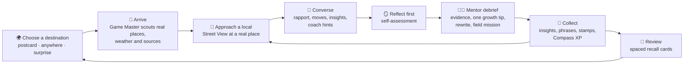
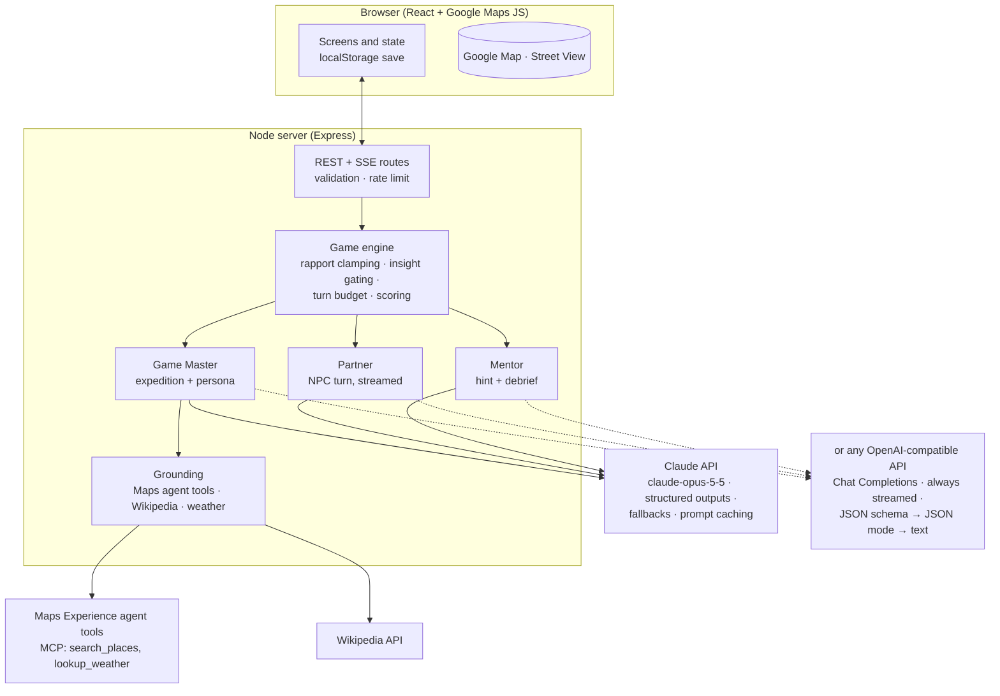

# Common Ground: Game Design Document

> *Explore the real world. Meet its people. Find common ground.*

Common Ground is a web game built around AI. The player travels anywhere on Earth through Google Maps, meets **AI locals grounded in the real place** (its nature, culture, history, society, and economy), and earns their trust using **real social skills**. After every conversation an **AI mentor** gives feedback grounded in established communication frameworks. Trust unlocks **insights about the world**, which go into a personal field journal and an atlas.

The game is built around one idea: **you learn about a place by talking well with its people, and you can't talk well with them without being curious about their world.** The social-skills loop and the world-learning loop are the same loop.

---

## 1. Learners and contexts

| Who | Why they play | What success looks like |
|---|---|---|
| Teens (13+) and adults building conversational confidence | Low-stakes rehearsal of conversations they find hard (starting them, listening, disagreeing, asking for help) | More open questions and reflections, fewer assumptions; real-world "field missions" completed |
| Students of geography, social studies, economics | Learning about places through people instead of lists of facts | Can explain how geography shapes livelihoods, or a custom in its own context |
| Future travelers, exchange students, newcomers to a city | Cultural humility and etiquette before the real thing | Checks assumptions, asks before acting, learns greetings and phrases |
| Educators (SEL + social studies) | A projected or 1:1 activity that ties CASEL competencies to world content | Discussion of debriefs; class reflection on calibration and perspective-taking |

**Not in scope:** clinical therapy, diagnosis, or replacing human relationships. The game says plainly that it's *rehearsal for real connection* (see §9.4).

---

## 2. Research foundations and the design decisions they drive

| Evidence | What it implies | Design decision |
|---|---|---|
| **AI Partner + AI Mentor (APAM)**: Yang et al., *Social Skill Training with Large Language Models* (arXiv:2404.04204, 2024) | Practice and feedback are different jobs and need different incentives | Two separate agents: the **Partner** (the NPC, in character) and the **Mentor** (out of character, evaluative). They have different prompts and outputs. |
| **CARE RCT** (Louie et al., 2025, arXiv:2505.02428, n≈90): practice-only raised confidence, but *skill gains required feedback*; the feedback group showed more empathy and was more client-centered | Practice without feedback mostly inflates confidence | Every encounter ends in a **mentor debrief** with quoted evidence, one strength, one growth area, and a rewrite of the learner's own line. On-demand **coach hints** mid-conversation. |
| **Rehearsal** (Shaikh et al., CHI '24, arXiv:2309.12309): LLM conflict simulation grounded in Interest–Rights–Power theory. Trained users used **67% fewer competitive tactics and 2× more cooperative ones** in a real conflict | Simulations work when grounded in a theory of the skill | "Perspective" and "negotiate" scenarios encode IRP/interest-based framing. Debrief rubrics use Fisher & Ury interest-based negotiation. |
| **Roleplay-doh** (Louie et al., EMNLP 2024): expert-written *principles* ("show initial skepticism", "don't disclose too much at first") make simulated partners realistic | Plain persona prompts produce characters that are too easy and too open | Every NPC follows a written **constitution**: realistic resistance, **trust-gated disclosure**, boundaries, and its own agenda. |
| **Social sycophancy** (ELEPHANT, arXiv:2505.13995): models over-validate users at high rates | An agreeable partner removes the friction that practice needs | Anti-sycophancy rules. Rapport is a number the *engine* tracks and gates, and generic politeness earns little. NPCs may be busy, disagree, or walk away. |
| **Marked Personas** (Cheng, Durmus & Jurafsky, ACL 2023): LLM-written personas for non-default groups contain more stereotypes, othering, and exoticizing language | Generated "locals" can easily become caricatures | A **persona charter**: individuals rather than representatives, modern everyday lives, variety within each place, banned tropes (exotic, timeless, "wise elder", broken English), and at least one local who challenges an outsider's assumption. |
| **OARS** (Miller & Rollnick, *Motivational Interviewing*); active listening | Open questions, Affirmations, Reflections, and Summaries are concrete, observable micro-skills | Curiosity, Listening, and Empathy rubrics; observable "moves" tagged each turn |
| **Intercultural competence process model** (Deardorff, 2006) | Respect, openness, and curiosity are attitudes that lead to knowledge and skills (listen, observe, interpret) | A dedicated **Respect** skill (cultural humility); assumptions and stereotypes are tagged and debriefed kindly |
| **Interest-based negotiation** (Fisher, Ury & Patton, *Getting to Yes*); IRP (Ury, Brett & Goldberg, 1988) | Focus on interests rather than positions; look for options that benefit both sides | **Clarity** and **Common Ground** skills; market negotiation and local-dispute scenarios |
| **Experiential learning cycle** (Kolb, 1984) | Learning = experience → reflection → conceptualization → experimentation | Encounter → **self-assessment before feedback** → skill cards (the concept) → focus skill for the next encounter, plus a real-world **field mission** |
| **Deliberate practice** (Ericsson et al., 1993) | Targeted goals, immediate feedback, repetition just beyond the current level | Per-encounter goal; per-turn "moves" feedback; focus skill; adaptive difficulty |
| **Adaptive difficulty / ZPD**; CARE's recommendation to tailor to the learner | Too easy is boring and too hard is discouraging | The Game Master sets NPC openness, starting rapport, and scenario type from the learner's skill profile |
| **Self-Determination Theory in games** (Ryan, Rigby & Przybylski, 2006) | Autonomy, competence, and relatedness drive lasting motivation | Go anywhere and choose your focus (autonomy); visible skill growth (competence); NPCs remember you (relatedness) |
| **Information-gap theory of curiosity** (Loewenstein, 1994) | Visible gaps in knowledge create the urge to fill them | A "curiosity board" of open questions per place; locked insight silhouettes; atlas completion by lens |
| **Retrieval practice** (Roediger & Karpicke, 2006); Leitner spaced repetition | Recalling information strengthens memory far more than re-reading it | Field Journal **recall cards** with spaced review |
| **Contact hypothesis** (Allport, 1954); **imagined contact** (Crisp & Turner, 2009) | Positive, individualized contact with other groups reduces prejudice | Warm, specific, individualized encounters across cultures, plus a nudge toward real contact through field missions |
| **Heavy chatbot use and loneliness** (MIT Media Lab & OpenAI 4-week RCT, 2025) | Heavy daily use correlates with worse psychosocial outcomes | Encounters are short and capped; field missions; a gentle daily-session nudge; framed as rehearsal for human connection |
| **Noora** (Stanford, 2025, waitlist-controlled trial): structured feedback on responses raised empathetic statements | Short, specific practice with feedback on one's own wording works | Mentor rewrites the learner's *own* line, not a generic example |

---

## 3. Learning objectives

**Social skills: the Skill Compass** (six skills, each with an observable rubric):

| Skill | Micro-behaviours we look for | Rooted in |
|---|---|---|
| 🧭 **Curiosity** | Open questions; genuine follow-ups; interest in the other person's world | OARS (O), Deardorff (curiosity) |
| 👂 **Listening** | Paraphrasing; reflecting; summarizing; building on what was said; remembering details | OARS (R, S), active listening |
| 💛 **Empathy** | Noticing and naming feelings; validating a perspective before responding | Perspective-taking, CARE |
| 🙏 **Respect** | Checking assumptions; asking permission; honoring norms and boundaries; avoiding stereotypes | Cultural humility, Deardorff |
| 🔆 **Clarity** | Stating needs and intent clearly and kindly; assertive rather than aggressive or vague | Assertiveness, NVC requests |
| 🤝 **Common Ground** | Finding shared interests; collaborating; interest-based problem-solving | Fisher & Ury, IRP |

**World understanding: five lenses**: 🌿 Nature (ecosystems, climate, landforms) · 🎭 Culture (traditions, food, arts, language, belief) · 📜 History (how the place came to be) · 🏘️ Society (community, education, health, public life) · 💰 Economy (livelihoods, trade, prices, work).

**Metacognition:** *calibration*, the gap between a learner's self-rating and the mentor's rating, is tracked and should shrink over time.

---

## 4. The core loop

An **expedition** (one place) takes 10–20 minutes and has three locals. An **encounter** (one conversation) is 6–14 player messages.

### 4.1 Choose
- **Postcards**: 15 curated destinations across six continents, each with a theme (e.g., *Oaxaca: market day*, *Rotterdam: living with water*, *Reykjavík: fire and ice economy*).
- **Go anywhere**: type a place or drop a pin anywhere on the map.
- **Surprise me**: a random unvisited postcard.
- The hub suggests a destination and scenario that fit the learner's **focus skill**.

### 4.2 Arrive (Game Master)
The server collects a **grounding pack** for the coordinates:
- *Google mode*: Maps Experience agent tools (`search_places` once per lens, `lookup_weather`)
- *Both modes*: Wikipedia geosearch (encyclopedic context), plus Open-Meteo weather in Open mode

The Game Master model then writes the expedition: a title, a scene grounded in the current weather and setting, a local greeting, a **curiosity board** (three open questions about the place), and **three locals** anchored to real nearby places. Each local has a lens, a scenario type, and a difficulty. Sources are listed with links.

### 4.3 Approach and converse (Partner)
Choosing a local opens Street View at their place (Google mode) and generates their full persona: personality, communication style, current situation, a hidden concern, boundaries, and three **insights** gated at rapport 30/55/75, each with a recall question.

During the conversation:
- **Rapport meter** (0–100) with tiers *Stranger → Acquainted → Warm → Trusted*, plus an emotion chip.
- **Moves**: under each player message, chips show the behaviors the local noticed (e.g., `open question` → +Curiosity, `assumption` → watch Respect). This is immediate, low-stakes feedback.
- **Insight cards** appear in the conversation when the local shares one ("📗 Why the matatus are painted").
- **Coach** (3 hints per encounter, to avoid over-reliance): one concrete suggestion plus an opener the learner can adapt.
- **Goal** (e.g., *"Find out why this market matters to the city"*), shown throughout.
- The conversation ends when the learner says goodbye, the local wraps up after the turn budget (soft cap 12, hard cap 16), or the local walks away after disrespect, which is a realistic consequence.

### 4.4 Reflect, then debrief (Mentor)
1. **Self-assessment first** (1–5 plus an optional note). This is the reflection step of Kolb's cycle, and it also covers the mentor's latency.
2. **Mentor debrief**: a summary; skill scores 0–4 with **verbatim quotes as evidence**; strengths; **one** growth focus with the learner's original line rewritten; "how your words landed" (the local's private reactions, revealed turn by turn); a calibration note; a reflection question; and a **field mission** for real life.
3. Rewards: XP, Compass growth, insights, phrases, a postcard stamp.

**Ask your mentor.** After the debrief the learner can ask up to five follow-up questions ("Why did I get that score?", "How could I have said that differently?", or their own). The mentor answers from the transcript, quoting the learner's words, and suggests two follow-ups. Explaining feedback on request keeps it from feeling like a verdict.

### 4.5 Collect and review
- **Field Journal**: insights by lens with sources, phrasebook (with pronunciation practice when voice is on), people met (revisit them; they remember you), missions, reflections.
- **Postcards**: after a debrief the learner can have a postcard of the place painted, a souvenir kept in the atlas. The prompt names only the place the player chose and the lenses they explored, never Google Maps content.

### 4.6 Classroom mode
Teachers use the game with a class, and the design keeps the privacy model intact while doing it:
- A teacher creates a class and gets a **class code** for students and a **teacher key**. The key is shown once and stored only as a hash.
- The teacher **assigns expeditions**: a place, a focus skill and a note. Students join with the code and see the assignments in their class view. Starting one switches the learner's focus skill to the assignment's, so the Game Master and the coach work on it. It stays their focus afterwards, until they choose another on the Compass.
- After a debrief on an assignment, the student chooses to **share a summary**: the rubric scores, the mentor's headline and growth skill, whether they reached the goal, their self-rating and its calibration gap. The conversation itself never leaves the browser.
- The **class debrief view** shows, per assignment: how many finished, the share who reached the goal, average scores per skill, the growth areas the mentor named most often, and the class's average calibration gap. A positive gap means the class rates itself higher than the mentor does; that is a good prompt for a discussion about self-assessment.
- Students are identified by the name they gave and a private id the server never shows. There are no accounts.
- Classes live in one JSON file on one instance, or in the database `DATABASE_URL` names: Postgres, shared by several instances behind a load balancer, or a SQLite file. In Postgres each change locks its class's row; in SQLite it holds the write lock from read to write. Either way, thirty students joining at once through different instances (or processes) are all recorded.
- **Recall**: insights become Leitner cards (boxes 1–5, intervals 0/1/3/7/16 days).
- **Atlas**: stamps on the world map; completion by lens and continent.

---

## 5. Scenarios and difficulty

| Scenario | Prompt to the learner | Primary skills |
|---|---|---|
| `conversation` | Strike up a conversation and learn their story | Curiosity, Listening |
| `ask_help` | Ask for help with something you need | Clarity, Respect |
| `support` | They're having a rough day; be there for them | Empathy, Listening |
| `negotiate` | Reach a fair deal | Clarity, Common Ground |
| `perspective` | They see a local issue differently; understand their view | Empathy, Respect, Common Ground |
| `tradition` | Take part in a local custom respectfully | Respect, Curiosity |
| `collaborate` | Work together on a small task | Common Ground, Clarity |

**Difficulty 1–3** sets the starting rapport (22/14/6), how open the local is, and how complex the challenge is. The Game Master picks it from the learner's level and targets their focus skill or weakest skill.

**Rapport rules** (enforced by the engine, not just the prompt):
- Each turn the local proposes `rapport_delta`, which is clamped to [−15, +12] and applied by the server.
- An insight is accepted only if the resulting rapport meets its threshold, at most one new insight per reply.
- If rapport drops to 0 or below, the local ends the conversation.
- The hidden concern is hinted at 60+ and revealed at 75+ only if the learner responds with care.

### 5.1 Mediation scenes: two locals at odds
Every expedition offers a harder challenge: two locals disagree about something everyday (tables on a shared pavement, band practice above a bakery, the only shady spot at the market), and the learner steps in. This is the game's namesake skill. It draws on interest-based negotiation (Fisher & Ury): each person has a stated **position**, an unspoken **interest** underneath it, and the two share an interest neither has noticed.

- The Game Master writes the scene from the expedition's grounding. The model plays both people each turn: one or both answer, each with a private reaction.
- **The engine owns the rules.** Tension (0–100) moves by at most ±15 a turn, and each person's trust by the usual rapport limits. An **agreement counts only when tension is at or below 45 and both trust the learner at least 40**; a model that declares a settlement earlier is overruled. Above 95 tension, someone walks off.
- Taking sides, judging or rushing a fix raises tension; reflecting each side, asking what matters to them and reframing toward the shared interest lowers it.
- The mentor debriefs it as a mediation (even-handedness, interests over positions, reframing), with both people's private reactions as evidence.

---

## 6. Progression and scoring

- **Skill rating** (0–100 per skill): each debrief score *s* ∈ {0..4} moves the rating toward *25·s* with an exponential moving average (α = 0.35 for the first three pieces of evidence, then 0.2). Skills that weren't exercised (null) don't move. Levels: Novice · Apprentice · Practitioner · Expert · Mentor.
- **XP**: rapport gained, insights (+15), goal achieved (+30), skill evidence, reflection completed (+10), recall answers (+5). Ranks: Newcomer → Visitor → Traveler → Wayfarer → Bridge-builder → Global Neighbor.
- **Calibration**: self-rating (1–5 → 0–4) compared with the mentor's mean score, shown as a trend.
- **Relationships**: locals you've met are saved with a short memory and their last rapport. Revisiting continues the relationship at 80% of that rapport.

---

## 7. AI system design

### 7.1 Three agents, one engine

- **Game Master** creates the expedition from the grounding pack, then each persona. It follows the persona charter (anti-stereotype rules) and a factual-grounding rule: every factual claim must come from the numbered sources or be general knowledge, and when the sources are thin it stays modest.
- **Partner (NPC)** follows the constitution. It returns structured JSON: `reply`, `gesture`, `emotion`, `rapport_delta`, `perceived_moves[]`, `inner_thought`, `revealed_insight_ids[]`, `phrase`, `conversation_state`.
- **Mentor** gives hints (short) and the debrief (rubric-scored, quoting evidence). It also sees the NPC's private `inner_thought` for each turn, so it can explain how each line landed.

**The model proposes; the engine decides.** All outputs are schema-validated (Zod). Rapport is clamped, insights are gated, IDs are checked against the persona, and the turn budget is enforced server-side. This makes the game rules reliable even when the model drifts.

### 7.2 Claude usage
- **Model**: `claude-opus-5-5` by default (configurable). **Effort** is set per task: `low` for NPC turns and hints (latency), `medium` for expedition, persona, and debrief (quality).
- **Structured outputs** (`output_config.format` with a JSON schema derived from Zod) for every call.
- **Streaming** NPC turns: the server pulls the `reply` string out of the partial JSON stream and sends it to the browser over SSE, so the local "speaks" as soon as tokens arrive.
- **Prompt caching**: a stable constitution, then the persona block (stable for the encounter), then an append-only transcript. Volatile per-turn state (rapport, wrap-up signal) lives in the newest user message, so the cached prefix survives.
- **Refusal fallback**: `fallbacks: "default"` (beta `server-side-fallback-2026-07-01`), with `stop_reason: "refusal"` handled explicitly.
- **Prompt-injection hygiene**: player text is wrapped in `<player>` tags and treated as dialogue. NPCs stay in character, and the server never runs instructions taken from model output.
- **Demo mode**: a deterministic scripted engine (heuristic move detection plus templates, grounded in real Wikipedia text). It has the same interface, so the full game runs without keys, and the e2e tests use it.

### 7.3 OpenAI-compatible models
Any server that speaks the Chat Completions API (OpenAI, model gateways, vLLM, Ollama) can play the three agents through the official `openai` SDK, with the same prompts as Claude. Servers differ in what they support, so the provider adapts:
- **Every call streams.** Thinking models can reason for minutes before their first output token. A non-streamed request stays silent all that time and runs into time-to-headers timeouts, which is what hung the first live run. Streaming also lets the NPC's `reply` reach the browser as it is written, as with Claude.
- **Structured output degrades gracefully.** It starts with strict `json_schema`, derived from the Zod schemas with every object closed and fully required. If the server rejects that, it tries `json_object`, then plain text with the schema in the prompt. A rejected mode is remembered for the life of the process.
- **Replies are repaired before validation.** Reasoning in `<think>` tags and code fences is stripped. Missing fields are filled, and loose enum values are matched (`"Warm"` → `warm`) or replaced. A reply that isn't JSON, or is an empty object (seen live from `qwen3.8-omni-flash`), gets one repair round. The engine then validates and clamps as usual, and asks for a persona once more if it came back without insights.
- **Claude-only features are absent.** There are no prompt-caching hints (many servers cache prefixes on their own) and no server-side refusal fallback. Refusals and content filters surface as errors.
- **Outputs are bounded.** Each task has an output cap (§7.4), sent as `max_tokens`, or as `max_completion_tokens` to OpenAI's reasoning models and to any server that asks for it. A server that ignores the cap is stopped by the game itself.
- **Calls are observable.** Each call logs time to first token, total time, reasoning size, the cap and the finish reason. `scripts/probe-ai.ts` checks which structured-output modes a server accepts in seconds.
- **Thinking is a per-task choice** (§7.4), and **each task can use its own model** (`AI_MODEL_<TASK>`).

### 7.4 Latency plan
| Step | Target | How |
|---|---|---|
| Arrive | ≈10–20 s | Map fly-in plus "scouting" progress steps; personas for all three locals are **prefetched in parallel** while the learner reads the briefing |
| NPC reply | first words ≈2–3 s | low effort plus streaming of `reply` |
| Debrief | ≈10–15 s | runs while the learner writes their self-assessment |

**Measured with a thinking model.** Two CI runs of the real-services suite (October 2026) used `qwen3.8-max` through an OpenAI-compatible gateway:

| Step | Before the first output token | Total |
|---|---|---|
| Expedition | 3.6–4 min (33–36k characters of reasoning) | 3.9–4.3 min |
| Persona (each; the three run in parallel) | 2–4.3 min | 2.3–4.6 min |
| NPC reply | 5–18 s | 7–20 s |
| Debrief | 1–2 min | 1.3–2.2 min |

Conversation is usable at this speed. Arrival takes more than ten times its target and the debrief five to thirteen times; almost all of that is reasoning.

**Improvements, all implemented in v2:**
1. **Thinking controls per task.** The provider sends the server's own switch, mapped from each task's effort: Qwen's `enable_thinking`, or OpenAI's `reasoning_effort`. The style is read from the model name or set with `AI_THINKING_STYLE`. With the default `AI_THINKING=auto`, only tasks at `high` effort or above think. A switch the server rejects is dropped for the rest of the process.
2. **A model per task** (`AI_MODEL_EXPEDITION`, `AI_MODEL_TURN`, …), for example a fast model for the Game Master and a stronger one for the mentor.
3. **Live progress.** Long calls answer with server-sent events: the phase (grounding, thinking, writing) with counts every 400 ms, and a keep-alive comment every 15 s. The arrival screen shows real progress and a clock, and proxies see a live connection.
4. **Two-stage arrival.** The server parses the streaming expedition and sends the briefing (title, scene, greeting, curiosity board) as soon as it is written. The learner reads it while the locals are still being written.

**Measured after.** Nine CI runs of the real-services suite on the v2 branch (October 2026), on the organization's `qwen3.8-omni-flash` with thinking off. The ranges cover every call those runs made:

| Step | Calls | First output token | Total |
|---|---|---|---|
| Expedition | 11 | 1.6–2.7 s in seven calls, 4–9 s in four | 9.5–20 s |
| Persona (each; the three run in parallel) | 32 | 1.4–10 s | 11–24 s |
| Mediation scene | 3 | 2.7–4 s | 11–13 s |
| Reply (a local, or both sides of a mediation) | 24 | 1.2–6.3 s, median 3.4 s | 2.8–11 s |
| Debrief | 8 | 1.6–5.4 s | 9.3–13.5 s |
| Hearing a spoken line (a 6–7 s clip) | 15 | | 4–20 s |
| Pronunciation score (a 1.5–3 s clip) | 15 | | 6.6–26 s, once 54 s |
| Postcard (Seedream through mm-gateway) | 13 | | 44–73 s |

Against the targets:
- **Arrival is met.** The expedition is written in 9.5–20 s, and its briefing shows before that. The locals are written while the learner reads it.
- **The debrief is met**: 9.3–13.5 s, against a target of 10–15 s.
- **Replies are close.** A reply streams as it is written, so its first words show at about the first token: a median of 3.4 s, and within 3 s in 10 of the 24 replies.

Two persona calls are left out of the table. One came back as an empty object after 4 s; that now gets a repair round (§7.3). The other ran to 22,000 characters, five times the usual length, and took 61 s.

The real-services expedition test went from 8.5–11 minutes to about 1. With voice and a postcard it takes 2.3–2.8 minutes, about a minute of which is the painting. The mediation test takes about a minute, and the whole suite 3.7–4 minutes. On the probe's tiny requests, the thinking switch halves the time: a median of 2.1 s with thinking off against 4.2 s with it (27 calls each).

**Next, from these measurements, all done in v3:**
1. **Each task's output is bounded** on OpenAI-compatible servers. A runaway persona kept its local waiting, and because the persona goes into every reply's prompt, it slowed the whole conversation too. The caps leave room for a full answer: 6,000 tokens for an expedition, 3,000 for a persona or scene, 4,000 for a debrief, 1,200 for a reply or a mentor's answer, 600 for a hint. A task that thinks gets 16,000 more, since many servers count reasoning as output. Servers that ignore the cap are stopped once the visible answer passes six characters per token of it. An answer cut off either way is asked for once more, with a request for brevity; if reasoning is what filled the cap, the retry gets the reasoning allowance as well. The caps can be changed per task on the settings page, and 0 turns one off.
2. **The heard words come first.** `/api/voice/listen` answers with server-sent events when asked: the transcript as the voice model writes it, then the delivery notes. The words fill the message box as they arrive, and the box stays read-only until the notes are in, so the line is sent with how it sounded. The voice log line records when the first words came.
3. **The time to the briefing is logged**, for every expedition: `[arrival] Kyoto openai grounding=…ms briefing=…ms locals=…ms walks=…ms total=…ms sources=…`. The briefing time is the wait a player actually sees on arrival.

### 7.5 Evaluation plan (for prompt iteration)
- **Partner realism**: on scripted learner transcripts (rude, generic, excellent), check that rapport moves in the right direction, insights are withheld before thresholds, and boundaries hold.
- **Stereotype audit**: generate personas for 50 places and run a marked-words scan (banned-trope lexicon). Human review samples.
- **Mentor fidelity**: every quoted piece of evidence must appear verbatim in the transcript (checked automatically). Rubric agreement with human raters on a labeled set.
- **Grounding**: insight facts are checked against the source extracts (LLM-judge plus spot checks).
- **Live smoke test**: on every push to `main`, CI's real-services suite plays one full expedition against Google Maps and the configured model, with voice and a postcard, plus a whole mediation. The server's per-call timing lines feed the measurements in §7.4.

**Implemented in v3** as `scripts/eval.ts`, on the game's own engine with a recorder around the model, so it measures the model's own drafts before the engine clamps, gates and filters them:
- partner realism: three scripted learners (excellent, generic, rude) talk with the same local. Rapport must rise for the first, fall for the last, and land between for the generic one. Insights the model offered before their threshold are counted (the engine refuses them anyway);
- mentor fidelity: the share of the mentor's quotes, evidence and the "you said" line alike, that are verbatim in the learner's lines (target 100%, a failure below 90%);
- stereotype audit: personas for every local in several places spread across continents, scanned for the tropes the persona charter bans (a failure) and a softer list worth a human look (reported);
- grounding: the share of each insight's content words found in the sources it cites, and with `--judge`, whether the model reading those sources says they support it.

It reports in Markdown and JSON. CI runs it on the omni model after the real-services suite, and with Claude in its own job once the repository has an `ANTHROPIC_API_KEY` secret. That job is the live evaluation pass with Claude; it is waiting only for the key.

### 7.6 Voice mode
Speaking is closer to real conversation than typing, and how something is said matters as much as what is said. With a **voice model** (an OpenAI-compatible model that hears audio: Qwen-Omni, gpt-4o-audio…):
- **Speak to locals.** The browser records 16 kHz mono WAV (no automatic gain or noise suppression, which distort tone). The voice model returns what was said, plus **delivery**: tone, pace, clarity, and one kind observation, never about accent. The transcript goes into the message box for the learner to check. The line is sent with its delivery: the local reacts to how it sounded, and the mentor may comment on it.
- **Pronunciation practice.** The learner records an attempt at the greeting or a phrase. The model scores how close it came (0–100) and gives one concrete tip.
- **Voices for locals.** If the voice model can speak, each local gets a consistent voice by pronouns (`VOICE_VOICES`). A model that rejects audio output, like the organization's omni model, is remembered, and the browser's speech takes over. A **speech model** (`VOICE_TTS_MODEL`, on the `/audio/speech` endpoint that OpenAI and most gateways offer) can give the locals their voices instead, beside a listening model that can't speak. It asks for WAV and falls back to MP3; a model the server doesn't have is remembered too.
- Recordings are sent to the voice model and never stored. Without a voice model, browser dictation and speech remain as before.

### 7.7 Images: postcards
Postcards are painted through [mm-gateway](https://github.com/sloth-os/mm-gateway), which holds the image provider's credentials. The game creates a task, polls it, and downloads the image (inline or from the provider). If the provider refuses its own output, the game asks once more with a new task. A player gets six postcards an hour, and each expedition's postcard is cached on the server. In the browser they live in IndexedDB, since they are too large for the save file.

### 7.8 Languages
The interface speaks English, Spanish, Simplified Chinese, French, Brazilian Portuguese and Japanese. The dictionaries are typed: a missing key fails the build, and a test checks that placeholders match. Game vocabulary is translated by id from the shared definitions. The player's language also goes into every prompt: the AI writes all player-facing text in it, keeps local greetings and phrases in the local language with meanings translated, and keeps the player's own quotes verbatim. Demo AI stays English.

---

## 8. Google Maps integration and terms compliance

What Google Maps contributes:
1. **Maps JavaScript API** (display): world map, Advanced Markers (postcards, stamps, locals), camera fly-ins, and **Street View** at each local's place for an on-the-ground view. While an expedition is prepared, a **photorealistic 3D fly-in** (`Map3DElement`, `maps3d` library) descends on the destination and circles it. It is skipped with reduced motion, or when the 3D library or WebGL isn't available.
2. **Maps Experience agent tools** (formerly *Maps Grounding Lite*; MCP at `https://mapstools.googleapis.com/mcp`): `search_places` (one query per lens near the destination) and `lookup_weather` ground the Game Master in real places and today's weather. The "go anywhere" text search also goes through `search_places`. Summaries come in the player's language (`language_code`). With `MAPS_WALKING_ROUTES`, `compute_routes` adds walking times to each local, shown with Google attribution and dropped with the coordinates after 30 days.

The v1 roadmap's "Pro agent-tools options (review-based place insights)" turned out not to exist. The documented tools are `search_places`, `lookup_weather`, `compute_routes`, `resolve_names` and `resolve_maps_urls`, without reviews. Places API reviews can't feed an LLM under §3.2.3(c), so walking routes and localized summaries took that slot.

Compliance design (see the Google Maps Platform Terms §3.2.3 and Service Specific Terms §10; this is not legal advice):
- **LLM content from Maps data only through the agent tools.** The terms forbid creating content from Google Maps Content (§3.2.3(c)). SST §10.2.1 allows grounding an LLM with Maps Experience agent tools if the output follows the Generative AI Prohibited Use Policy and **shows the associated Google Maps source links**. Every expedition, local card, and insight drawn from Maps data shows its Google Maps link. We never pass Places Autocomplete or Geocoder results to the LLM.
- **No caching of raw Maps content.** Raw tool results are held in server memory only for the active session (≤ 2 h) and never persisted. The AI-written expedition (Grounded Output) may be kept in the learner's history (SST §10.2.2 allows chat history up to 2 years). Coordinates of Maps places in saved expeditions, including destinations picked from Google search results, are dropped after 30 days.
- **Google coordinates stay inside Google's services.** When a destination comes from a Google search result, third-party lookups use the player's own words instead: Wikipedia text search rather than geosearch, and no Open-Meteo or Nominatim call.
- **Citations map to sources.** Each `search_places` summary cites its results by position (`[0]`). The Game Master's prompt lists, for every search, which global source id (`P#`) each position refers to, so grounded text and map pins stay linked to the right Google Maps link.
- **No mixing with non-Google maps.** Open mode (MapLibre + OpenFreeMap + Wikipedia) is a *separate mode* used only when no Google key is configured. Google content and the open map never appear together (§3.2.3(e)).
- **Voice**: whether locals speak through the voice model or the browser, the verbatim transcript stays on screen (the companion log). The voice settings carry a persistent notice that AI output may include Google Maps content, as the agent-tools documentation requires for voice interfaces.
- **Postcards** are painted from the place the player chose and the lenses explored, never from Google Maps content.
- **Switching maps** (now possible without a restart, §10): an expedition planned on Google Maps, opened after the server moved to the open map, shows a notice instead of its places, and atlas stamps from Google search results stay off the open map.
- **No training**: Grounded Output is never used to train models (§10.3.2). Anthropic's commercial API terms state that API inputs and outputs aren't used for training by default.

---

## 9. Safety, ethics, and inclusion

1. **Persona charter** (against stereotypes): people, not representatives; modern everyday specifics; variety in age, gender, class, profession, and opinion; no exoticizing adjectives, no poverty-as-identity, no "wise elder" or noble-savage tropes, no phonetic accents or broken English; local-language words used naturally and always translated.
2. **Factual humility**: NPCs share insights in their own words, from experience. If asked something beyond their knowledge, they answer like an ordinary person ("not sure, honestly"). Sources are always one tap away. A disclosure says characters are fictional and AI-generated.
3. **Content**: NPC content is suitable for ages 13+ in every mode. If the learner harasses an NPC, it responds as a self-respecting person and ends the encounter, and the mentor addresses it without shaming.
4. **Healthy use**: encounters are short; field missions push practice into real life; after a few encounters in a day the game suggests a break and a real conversation.
5. **Privacy**: no accounts; progress lives in `localStorage` (postcards in IndexedDB) with export and reset. Voice recordings are transcribed and discarded. API keys stay server-side, except the browser Maps key, which is HTTP-referrer-restricted by design. In classroom mode a student shares only summaries of assigned conversations: scores, the mentor's headline, goal reached, self-rating calibration. Transcripts never leave the browser. A teacher's key is shown once and stored only as a hash. Students' ids stay on the server. The settings page is the operator's: its key is kept only as a hash, secrets saved there sit in a file only the server can read (or the database), and the page is sent their last characters, never the values.
6. **Accessibility**: keyboard-first, ARIA live region for NPC replies, color always paired with text or icons, `prefers-reduced-motion` (which also skips 3D fly-ins), adjustable text size, voice input and output, mobile layout.
7. **Languages and scripts**: English, Spanish and Simplified Chinese, with the AI writing in the player's language. Two font fixes help here. Fraunces misplaces the macron of ā ē ī ō ū (Kyōto, Māori), so a Literata subset draws just those letters. Noto Sans SC, fetched in slices, covers devices without a CJK font.

---

## 10. Technical architecture

| Layer | Choice | Why |
|---|---|---|
| Client | React 19 + TypeScript + Vite | Component-based UI for many screens; fast dev server |
| Maps | `@googlemaps/js-api-loader` (Maps JS: maps, marker, streetView) / MapLibre GL (Open mode) | Official loader; open fallback for keyless play and tests |
| Server | Node ≥ 22.18 (native TypeScript), Express 5 | Stateless; keeps keys secret; streams SSE |
| AI | `@anthropic-ai/sdk` (beta messages: structured outputs, fallbacks); `openai` for OpenAI-compatible Chat Completions | Official SDKs |
| Maps grounding | `@modelcontextprotocol/sdk` client → Maps Experience agent tools | Official MCP client; Streamable HTTP + `X-Goog-Api-Key` |
| Validation | Zod 4 | Shared schemas for requests and AI outputs |
| Voice | OpenAI SDK against an omni model: `input_audio` in; `modalities: ["text","audio"]` out where supported; browser Web Speech API otherwise | One client for hearing and speaking |
| Images | mm-gateway REST (`/v1/images`) | The gateway holds provider keys and routes models |
| Classroom | One JSON file under `DATA_DIR`, written atomically; or Postgres (`pg`) for several instances; or SQLite (`node:sqlite`, built into Node) | Small classes, nothing to install; a shared store when one instance isn't enough; one database file without running a database server |
| Settings | A catalog of every variable (`shared/settings.ts`), layered over the environment, kept in `settings.json`, Postgres or SQLite | One description drives the server's validation and the page's form |
| i18n | Typed dictionaries (`src/i18n`), vocabulary by id | No runtime dependency; missing keys fail the build |
| Tests | Vitest (unit/integration, fake `fetch` for the Claude and OpenAI SDKs, fake omni and gateway servers), Playwright (e2e in Open + Demo mode on desktop Chromium and Android; a real-services suite with Google Maps, the omni model, voice through a fake microphone, and postcards) | Full coverage without keys, plus a keyed run of the real thing in CI |

**Operations.** Open-data responses are cached (Wikipedia and Nominatim for 24 h, weather for 15 min) and retried once when rate-limited, and requests carry an identifying User-Agent. AI routes are rate-limited **per player**, using a browser-generated id, with a 10× ceiling per IP, so a classroom behind one IP isn't throttled as one person. An optional `ACCESS_CODE` gates classroom deployments.

**State model.** The client is the source of truth: the save file holds the profile, skills, journal, and the current expedition, encounter or mediation. The gameplay server is stateless apart from short-lived in-memory caches (grounding, recent speech, today's postcards), so any instance can serve any request. Each turn request carries the persona and transcript, with sizes limited by the schemas. Classes and settings are the exceptions: in files on one instance, in Postgres shared by all of them, or in a SQLite file.

**Settings and hot reload.** The server configures itself from three layers: `.env`, the process environment, and the values saved on the settings page, which win until they are reset. Every variable is described once (`shared/settings.ts`): its kind, its options, the variables that stand in for it (`ANTHROPIC_API_KEY` for `AI_API_KEY`), whether it is a secret, and whether it is read only at start (`PORT`, `DATA_DIR`, `DATABASE_URL`, `ADMIN_KEY`, `SETTINGS_PAGE`). A change is validated, saved, and applied by the runtime, which compares a fingerprint of each service's part of the configuration and rebuilds only those that changed: the AI, voice, postcards, Maps agent tools, grounding (keeping its caches), classes, or access and limits. Requests in flight keep the services they started with. Changes from outside the page apply the same way: an edit to `settings.json` or `.env` (watched), another instance's save (Postgres `NOTIFY`), or another process's write to the SQLite file (SQLite can't announce changes, so the server checks the file's `data_version` every second, which moves only when another connection commits). A change that wouldn't run is refused on the page and ignored, with a log line, from a file. Browsers fetch `/api/config` again every minute and when the tab comes back into view; its `revision` tells them the configuration changed, and the map is rebuilt only if a map setting did.

The page is guarded by a settings key: `ADMIN_KEY`, or one the server makes at first start, prints once and keeps only as a hash (`scripts/settings-key.ts` replaces it). Wrong keys are counted per address; after 20 in 15 minutes the address waits, right key or not. Each section's **Test** button checks a service with the form's values before they are saved, cheaply: a few tokens of text, a second of silence to hear and a word to speak, the gateway's model list, one place search.

**API surface.**
| Route | Purpose |
|---|---|
| `GET /api/config` | Modes (google/open, claude/openai/demo), browser Maps key, map ID, feature flags, and the configuration's revision |
| `GET /api/geo/search?q=` | "Go anywhere" search (agent tools `search_places` in Google mode; Nominatim in Open mode) |
| `POST /api/expedition` | Grounding pack → expedition (title, scene, greeting, curiosity board, three locals, sources) |
| `POST /api/npc/persona` | Full persona for one local (insights with recall quizzes) |
| `POST /api/npc/turn` | SSE: `reply` deltas, then the validated turn (rapport, moves, insights, state) |
| `POST /api/coach/hint` | One concrete mid-conversation suggestion |
| `POST /api/coach/debrief` | Rubric-scored debrief with evidence, rewrite, calibration, field mission |
| `POST /api/coach/ask` | SSE: the mentor's answer to a follow-up question, then two suggested follow-ups |
| `POST /api/mediation/scene` · `/turn` · `/debrief` | Two locals at odds: the scene, each turn (SSE; both parties, tension, trust), the mediation debrief |
| `POST /api/voice/listen` · `/pronounce` · `/speak` | What was said (streamed first, with `text/event-stream`) and how it sounded; a pronunciation score; a local's line as audio (501 if no model can speak) |
| `POST /api/postcard` | A painted postcard of the place (JPEG/PNG) |
| `POST /api/classes` · `GET /api/classes/:code` · `POST …/join` · `POST …/results` · `GET …/dashboard` · `POST`/`DELETE …/assignments` | Classroom mode (the dashboard and assignments need the teacher's key) |
| `GET /api/admin/status` · `POST …/session` · `GET`/`PUT …/settings` · `POST …/test` · `POST …/key` | The settings page: whether it's on, checking a key, the settings and what is running, saving (applied at once), testing a service, a new key. All but `status` need the settings key; none needs the players' access code. |

Long calls (expedition, persona, scene, debrief) answer with **server-sent events when the browser asks for `text/event-stream`**: `progress`, then for expeditions an early `briefing`, then `result`. Clients that don't ask get one JSON body.

---

## 11. Success metrics

- **Learning**: Compass rating growth per skill; share of player turns with open questions or reflections; fewer `assumption`/`judgment` moves; calibration gap shrinking; recall accuracy; field missions completed.
- **Experience**: encounter completion rate; return visits within 7 days; hint usage trend (should fall as skill rises); debrief helpfulness (thumbs up/down).
- **Quality**: NPC rule adherence (eval suite in §7.5); verbatim-evidence rate in the mentor's quotes = 100%; stereotype-audit flags per 100 personas.
- **Classes**: assignment completion; class averages per skill over time; how often the mentor names each growth area; the class's calibration gap (§4.6).

---

## 12. Roadmap

- **v1**: the core loop, playable in Google or Open mode, with Claude, any OpenAI-compatible model, or Demo AI.
- **v2**: everything that was planned for v1.1 and v2.
  - Faster arrival: thinking controls, a model per task, live progress, two-stage briefing (§7.4).
  - Correct macron letters.
  - Richer voice mode: speech with delivery, pronunciation practice, voices per local (§7.6).
  - 3D fly-ins.
  - 33 postcards across six continents, plus painted postcard souvenirs (§7.7).
  - The interface and the AI in English, Spanish and Simplified Chinese (§7.8).
  - Classroom mode with a class debrief view.
  - Mediation scenes (§5.1).
  - Questions to the mentor (§4.4).
  - Walking routes and localized place summaries, in place of the review insights the agent tools don't offer (§8).
- **v3 (this build)**: everything on v2's "next" list that code can do.
  - The three steps the v2 measurements pointed to: bounded outputs, the heard words first, and the time to the briefing (§7.4).
  - Server settings in the browser, behind a key, applied without a restart, as are edits to `settings.json` and `.env` (§10).
  - A shared Postgres store, so classroom mode and the settings run on several instances, or a SQLite file for one machine without a database server (§4.6, §10).
  - The evaluation pass as code, run in CI on the omni model, and with Claude once a key is there (§7.5).
  - Speaking locals through a speech model (§7.6), checked live in CI once one is configured.
  - Maps agent tools and walking routes probed live and asserted in the real suite once CI has a server key (§8).
  - French, Brazilian Portuguese and Japanese (§7.8).
  - Mediation and voice on the Android test devices, and voice mode in the desktop browser tests against a stand-in voice model.
- **Next**: what code can't do on its own.
  - The live runs that wait only for credentials: Claude (`ANTHROPIC_API_KEY`), the Maps agent tools and walking routes (`GOOGLE_MAPS_SERVER_KEY`), and a speaking voice (`VOICE_TTS_MODEL`). CI runs each as soon as it is set; their results should then be written up here, as v2's measurements were.
  - Prompt changes driven by what the evaluation reports find.

## References

- Yang, D., Ziems, C., Held, W., Shaikh, O., Bernstein, M. S., & Mitchell, J. (2024). *Social Skill Training with Large Language Models.* arXiv:2404.04204.
- Shaikh, O., Chai, V., Gelfand, M., Yang, D., & Bernstein, M. S. (2024). *Rehearsal: Simulating Conflict to Teach Conflict Resolution.* CHI '24. arXiv:2309.12309.
- Louie, R., et al. (2024). *Roleplay-doh: Enabling Domain-Experts to Create LLM-simulated Patients via Eliciting and Adhering to Principles.* EMNLP 2024. arXiv:2407.00870.
- Louie, R., et al. (2025). CARE: LLM-simulated practice and feedback for novice counselors, randomized study. arXiv:2505.02428. Summary: Stanford HAI, *Using LLMs to Improve Workplace Social Skills*.
- Cheng, M., Durmus, E., & Jurafsky, D. (2023). *Marked Personas: Using Natural Language Prompts to Measure Stereotypes in Language Models.* ACL 2023.
- *ELEPHANT: Measuring and understanding social sycophancy in LLMs* (2025). arXiv:2505.13995.
- Miller, W. R., & Rollnick, S. *Motivational Interviewing* (OARS).
- Deardorff, D. K. (2006). Identification and assessment of intercultural competence. *Journal of Studies in International Education*, 10(3).
- Fisher, R., Ury, W., & Patton, B. *Getting to Yes.* Ury, W., Brett, J., & Goldberg, S. (1988). *Getting Disputes Resolved.*
- Kolb, D. A. (1984). *Experiential Learning.*
- Ericsson, K. A., Krampe, R. T., & Tesch-Römer, C. (1993). The role of deliberate practice in the acquisition of expert performance. *Psychological Review*, 100(3).
- Ryan, R. M., Rigby, C. S., & Przybylski, A. (2006). The motivational pull of video games: A self-determination theory approach. *Motivation and Emotion*, 30.
- Loewenstein, G. (1994). The psychology of curiosity. *Psychological Bulletin*, 116(1).
- Roediger, H. L., & Karpicke, J. D. (2006). Test-enhanced learning. *Psychological Science*, 17(3).
- Allport, G. W. (1954). *The Nature of Prejudice.* Crisp, R. J., & Turner, R. N. (2009). Can imagined interactions produce positive perceptions? *American Psychologist*, 64(4).
- Fang, C. M., et al. (2025). How AI and human behaviors shape psychosocial effects of chatbot use: A longitudinal randomized controlled study. MIT Media Lab & OpenAI.
- Google Maps Platform Terms of Service §3.2.3; Google Maps Platform Service Specific Terms §10 (Maps Experience Agent Tools); Maps Experience agent tools documentation (developers.google.com/maps/ai/grounding-lite).
