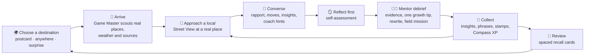
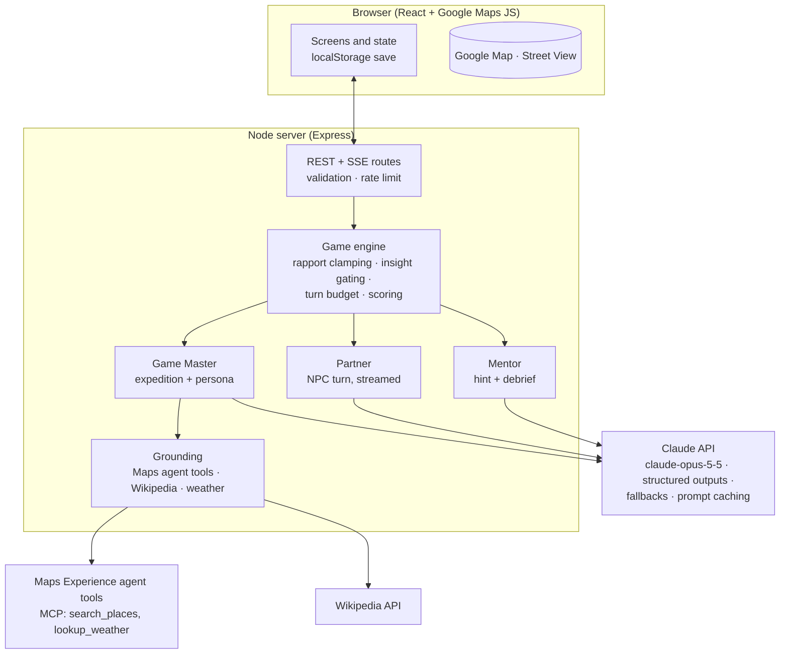

# Common Ground: Game Design Document

> *Explore the real world. Meet its people. Find common ground.*

Common Ground is a web game built around AI. The player travels anywhere on Earth through Google Maps, meets **AI locals grounded in the real place** (its nature, culture, history, society, and economy), and earns their trust using **real social skills**. After every conversation an **AI mentor** gives feedback grounded in established communication frameworks. Trust unlocks **insights about the world**, which go into a personal field journal and an atlas.

The game is built around one idea: **you learn about a place by talking well with its people, and you can't talk well with them without being curious about their world.** The social-skills loop and the world-learning loop are the same loop.

---

## 1. Learners and contexts

| Who | Why they play | What success looks like |
|---|---|---|
| Teens (13+) and adults building conversational confidence | Low-stakes rehearsal of conversations they find hard (starting them, listening, disagreeing, asking for help) | More open questions and reflections, fewer assumptions; real-world "field missions" completed |
| Students of geography, social studies, economics | Learning about places through people instead of lists of facts | Can explain how geography shapes livelihoods, or a custom in its own context |
| Future travelers, exchange students, newcomers to a city | Cultural humility and etiquette before the real thing | Checks assumptions, asks before acting, learns greetings and phrases |
| Educators (SEL + social studies) | A projected or 1:1 activity that ties CASEL competencies to world content | Discussion of debriefs; class reflection on calibration and perspective-taking |

**Not in scope:** clinical therapy, diagnosis, or replacing human relationships. The game says plainly that it's *rehearsal for real connection* (see §9.4).

---

## 2. Research foundations and the design decisions they drive

| Evidence | What it implies | Design decision |
|---|---|---|
| **AI Partner + AI Mentor (APAM)**: Yang et al., *Social Skill Training with Large Language Models* (arXiv:2404.04204, 2024) | Practice and feedback are different jobs and need different incentives | Two separate agents: the **Partner** (the NPC, in character) and the **Mentor** (out of character, evaluative). They have different prompts and outputs. |
| **CARE RCT** (Louie et al., 2025, arXiv:2505.02428, n≈90): practice-only raised confidence, but *skill gains required feedback*; the feedback group showed more empathy and was more client-centered | Practice without feedback mostly inflates confidence | Every encounter ends in a **mentor debrief** with quoted evidence, one strength, one growth area, and a rewrite of the learner's own line. On-demand **coach hints** mid-conversation. |
| **Rehearsal** (Shaikh et al., CHI '24, arXiv:2309.12309): LLM conflict simulation grounded in Interest–Rights–Power theory. Trained users used **67% fewer competitive tactics and 2× more cooperative ones** in a real conflict | Simulations work when grounded in a theory of the skill | "Perspective" and "negotiate" scenarios encode IRP/interest-based framing. Debrief rubrics use Fisher & Ury interest-based negotiation. |
| **Roleplay-doh** (Louie et al., EMNLP 2024): expert-written *principles* ("show initial skepticism", "don't disclose too much at first") make simulated partners realistic | Plain persona prompts produce characters that are too easy and too open | Every NPC follows a written **constitution**: realistic resistance, **trust-gated disclosure**, boundaries, and its own agenda. |
| **Social sycophancy** (ELEPHANT, arXiv:2505.13995): models over-validate users at high rates | An agreeable partner removes the friction that practice needs | Anti-sycophancy rules. Rapport is a number the *engine* tracks and gates, and generic politeness earns little. NPCs may be busy, disagree, or walk away. |
| **Marked Personas** (Cheng, Durmus & Jurafsky, ACL 2023): LLM-written personas for non-default groups contain more stereotypes, othering, and exoticizing language | Generated "locals" can easily become caricatures | A **persona charter**: individuals rather than representatives, modern everyday lives, variety within each place, banned tropes (exotic, timeless, "wise elder", broken English), and at least one local who challenges an outsider's assumption. |
| **OARS** (Miller & Rollnick, *Motivational Interviewing*); active listening | Open questions, Affirmations, Reflections, and Summaries are concrete, observable micro-skills | Curiosity, Listening, and Empathy rubrics; observable "moves" tagged each turn |
| **Intercultural competence process model** (Deardorff, 2006) | Respect, openness, and curiosity are attitudes that lead to knowledge and skills (listen, observe, interpret) | A dedicated **Respect** skill (cultural humility); assumptions and stereotypes are tagged and debriefed kindly |
| **Interest-based negotiation** (Fisher, Ury & Patton, *Getting to Yes*); IRP (Ury, Brett & Goldberg, 1988) | Focus on interests rather than positions; look for options that benefit both sides | **Clarity** and **Common Ground** skills; market negotiation and local-dispute scenarios |
| **Experiential learning cycle** (Kolb, 1984) | Learning = experience → reflection → conceptualization → experimentation | Encounter → **self-assessment before feedback** → skill cards (the concept) → focus skill for the next encounter, plus a real-world **field mission** |
| **Deliberate practice** (Ericsson et al., 1993) | Targeted goals, immediate feedback, repetition just beyond the current level | Per-encounter goal; per-turn "moves" feedback; focus skill; adaptive difficulty |
| **Adaptive difficulty / ZPD**; CARE's recommendation to tailor to the learner | Too easy is boring and too hard is discouraging | The Game Master sets NPC openness, starting rapport, and scenario type from the learner's skill profile |
| **Self-Determination Theory in games** (Ryan, Rigby & Przybylski, 2006) | Autonomy, competence, and relatedness drive lasting motivation | Go anywhere and choose your focus (autonomy); visible skill growth (competence); NPCs remember you (relatedness) |
| **Information-gap theory of curiosity** (Loewenstein, 1994) | Visible gaps in knowledge create the urge to fill them | A "curiosity board" of open questions per place; locked insight silhouettes; atlas completion by lens |
| **Retrieval practice** (Roediger & Karpicke, 2006); Leitner spaced repetition | Recalling information strengthens memory far more than re-reading it | Field Journal **recall cards** with spaced review |
| **Contact hypothesis** (Allport, 1954); **imagined contact** (Crisp & Turner, 2009) | Positive, individualized contact with other groups reduces prejudice | Warm, specific, individualized encounters across cultures, plus a nudge toward real contact through field missions |
| **Heavy chatbot use and loneliness** (MIT Media Lab & OpenAI 4-week RCT, 2025) | Heavy daily use correlates with worse psychosocial outcomes | Encounters are short and capped; field missions; a gentle daily-session nudge; framed as rehearsal for human connection |
| **Noora** (Stanford, 2025, waitlist-controlled trial): structured feedback on responses raised empathetic statements | Short, specific practice with feedback on one's own wording works | Mentor rewrites the learner's *own* line, not a generic example |

---

## 3. Learning objectives

**Social skills: the Skill Compass** (six skills, each with an observable rubric):

| Skill | Micro-behaviours we look for | Rooted in |
|---|---|---|
| 🧭 **Curiosity** | Open questions; genuine follow-ups; interest in the other person's world | OARS (O), Deardorff (curiosity) |
| 👂 **Listening** | Paraphrasing; reflecting; summarizing; building on what was said; remembering details | OARS (R, S), active listening |
| 💛 **Empathy** | Noticing and naming feelings; validating a perspective before responding | Perspective-taking, CARE |
| 🙏 **Respect** | Checking assumptions; asking permission; honoring norms and boundaries; avoiding stereotypes | Cultural humility, Deardorff |
| 🔆 **Clarity** | Stating needs and intent clearly and kindly; assertive rather than aggressive or vague | Assertiveness, NVC requests |
| 🤝 **Common Ground** | Finding shared interests; collaborating; interest-based problem-solving | Fisher & Ury, IRP |

**World understanding: five lenses**: 🌿 Nature (ecosystems, climate, landforms) · 🎭 Culture (traditions, food, arts, language, belief) · 📜 History (how the place came to be) · 🏘️ Society (community, education, health, public life) · 💰 Economy (livelihoods, trade, prices, work).

**Metacognition:** *calibration*, the gap between a learner's self-rating and the mentor's rating, is tracked and should shrink over time.

---

## 4. The core loop

An **expedition** (one place) takes 10–20 minutes and has three locals. An **encounter** (one conversation) is 6–14 player messages.

### 4.1 Choose
- **Postcards**: 15 curated destinations across six continents, each with a theme (e.g., *Oaxaca: market day*, *Rotterdam: living with water*, *Reykjavík: fire and ice economy*).
- **Go anywhere**: type a place or drop a pin anywhere on the map.
- **Surprise me**: a random unvisited postcard.
- The hub suggests a destination and scenario that fit the learner's **focus skill**.

### 4.2 Arrive (Game Master)
The server collects a **grounding pack** for the coordinates:
- *Google mode*: Maps Experience agent tools (`search_places` once per lens, `lookup_weather`)
- *Both modes*: Wikipedia geosearch (encyclopedic context), plus Open-Meteo weather in Open mode

Claude then writes the expedition: a title, a scene grounded in the current weather and setting, a local greeting, a **curiosity board** (three open questions about the place), and **three locals** anchored to real nearby places. Each local has a lens, a scenario type, and a difficulty. Sources are listed with links.

### 4.3 Approach and converse (Partner)
Choosing a local opens Street View at their place (Google mode) and generates their full persona: personality, communication style, current situation, a hidden concern, boundaries, and three **insights** gated at rapport 30/55/75, each with a recall question.

During the conversation:
- **Rapport meter** (0–100) with tiers *Stranger → Acquainted → Warm → Trusted*, plus an emotion chip.
- **Moves**: under each player message, chips show the behaviors the local noticed (e.g., `open question` → +Curiosity, `assumption` → watch Respect). This is immediate, low-stakes feedback.
- **Insight cards** appear in the conversation when the local shares one ("📗 Why the matatus are painted").
- **Coach** (3 hints per encounter, to avoid over-reliance): one concrete suggestion plus an opener the learner can adapt.
- **Goal** (e.g., *"Find out why this market matters to the city"*), shown throughout.
- The conversation ends when the learner says goodbye, the local wraps up after the turn budget (soft cap 12, hard cap 16), or the local walks away after disrespect, which is a realistic consequence.

### 4.4 Reflect, then debrief (Mentor)
1. **Self-assessment first** (1–5 plus an optional note). This is the reflection step of Kolb's cycle, and it also covers the mentor's latency.
2. **Mentor debrief**: a summary; skill scores 0–4 with **verbatim quotes as evidence**; strengths; **one** growth focus with the learner's original line rewritten; "how your words landed" (the local's private reactions, revealed turn by turn); a calibration note; a reflection question; and a **field mission** for real life.
3. Rewards: XP, Compass growth, insights, phrases, a postcard stamp.

### 4.5 Collect and review
- **Field Journal**: insights by lens with sources, phrasebook, people met (revisit them; they remember you), missions, reflections.
- **Recall**: insights become Leitner cards (boxes 1–5, intervals 0/1/3/7/16 days).
- **Atlas**: stamps on the world map; completion by lens and continent.

---

## 5. Scenarios and difficulty

| Scenario | Prompt to the learner | Primary skills |
|---|---|---|
| `conversation` | Strike up a conversation and learn their story | Curiosity, Listening |
| `ask_help` | Ask for help with something you need | Clarity, Respect |
| `support` | They're having a rough day; be there for them | Empathy, Listening |
| `negotiate` | Reach a fair deal | Clarity, Common Ground |
| `perspective` | They see a local issue differently; understand their view | Empathy, Respect, Common Ground |
| `tradition` | Take part in a local custom respectfully | Respect, Curiosity |
| `collaborate` | Work together on a small task | Common Ground, Clarity |

**Difficulty 1–3** sets the starting rapport (22/14/6), how open the local is, and how complex the challenge is. The Game Master picks it from the learner's level and targets their focus skill or weakest skill.

**Rapport rules** (enforced by the engine, not just the prompt):
- Each turn the local proposes `rapport_delta`, which is clamped to [−15, +12] and applied by the server.
- An insight is accepted only if the resulting rapport meets its threshold, at most one new insight per reply.
- If rapport drops to 0 or below, the local ends the conversation.
- The hidden concern is hinted at 60+ and revealed at 75+ only if the learner responds with care.

---

## 6. Progression and scoring

- **Skill rating** (0–100 per skill): each debrief score *s* ∈ {0..4} moves the rating toward *25·s* with an exponential moving average (α = 0.35 for the first three pieces of evidence, then 0.2). Skills that weren't exercised (null) don't move. Levels: Novice · Apprentice · Practitioner · Expert · Mentor.
- **XP**: rapport gained, insights (+15), goal achieved (+30), skill evidence, reflection completed (+10), recall answers (+5). Ranks: Newcomer → Visitor → Traveler → Wayfarer → Bridge-builder → Global Neighbor.
- **Calibration**: self-rating (1–5 → 0–4) compared with the mentor's mean score, shown as a trend.
- **Relationships**: locals you've met are saved with a short memory and their last rapport. Revisiting continues the relationship at 80% of that rapport.

---

## 7. AI system design

### 7.1 Three agents, one engine

- **Game Master** creates the expedition from the grounding pack, then each persona. It follows the persona charter (anti-stereotype rules) and a factual-grounding rule: every factual claim must come from the numbered sources or be general knowledge, and when the sources are thin it stays modest.
- **Partner (NPC)** follows the constitution. It returns structured JSON: `reply`, `gesture`, `emotion`, `rapport_delta`, `perceived_moves[]`, `inner_thought`, `revealed_insight_ids[]`, `phrase`, `conversation_state`.
- **Mentor** gives hints (short) and the debrief (rubric-scored, quoting evidence). It also sees the NPC's private `inner_thought` for each turn, so it can explain how each line landed.

**The model proposes; the engine decides.** All outputs are schema-validated (Zod). Rapport is clamped, insights are gated, IDs are checked against the persona, and the turn budget is enforced server-side. This makes the game rules reliable even when the model drifts.

### 7.2 Claude usage
- **Model**: `claude-opus-5-5` by default (configurable). **Effort** is set per task: `low` for NPC turns and hints (latency), `medium` for expedition, persona, and debrief (quality).
- **Structured outputs** (`output_config.format` with a JSON schema derived from Zod) for every call.
- **Streaming** NPC turns: the server pulls the `reply` string out of the partial JSON stream and sends it to the browser over SSE, so the local "speaks" as soon as tokens arrive.
- **Prompt caching**: a stable constitution, then the persona block (stable for the encounter), then an append-only transcript. Volatile per-turn state (rapport, wrap-up signal) lives in the newest user message, so the cached prefix survives.
- **Refusal fallback**: `fallbacks: "default"` (beta `server-side-fallback-2026-07-01`), with `stop_reason: "refusal"` handled explicitly.
- **Prompt-injection hygiene**: player text is wrapped in `<player>` tags and treated as dialogue. NPCs stay in character, and the server never runs instructions taken from model output.
- **Demo mode**: a deterministic scripted engine (heuristic move detection plus templates, grounded in real Wikipedia text). It has the same interface, so the full game runs without keys, and the e2e tests use it.

### 7.3 Latency plan
| Step | Target | How |
|---|---|---|
| Arrive | ≈10–20 s | Map fly-in plus "scouting" progress steps; personas for all three locals are **prefetched in parallel** while the learner reads the briefing |
| NPC reply | first words ≈2–3 s | low effort plus streaming of `reply` |
| Debrief | ≈10–15 s | runs while the learner writes their self-assessment |

### 7.4 Evaluation plan (for prompt iteration)
- **Partner realism**: on scripted learner transcripts (rude, generic, excellent), check that rapport moves in the right direction, insights are withheld before thresholds, and boundaries hold.
- **Stereotype audit**: generate personas for 50 places and run a marked-words scan (banned-trope lexicon). Human review samples.
- **Mentor fidelity**: every quoted piece of evidence must appear verbatim in the transcript (checked automatically). Rubric agreement with human raters on a labeled set.
- **Grounding**: insight facts are checked against the source extracts (LLM-judge plus spot checks).

---

## 8. Google Maps integration and terms compliance

What Google Maps contributes:
1. **Maps JavaScript API** (display): world map, Advanced Markers (postcards, stamps, locals), camera fly-ins, and **Street View** at each local's place for an on-the-ground view.
2. **Maps Experience agent tools** (formerly *Maps Grounding Lite*; MCP at `https://mapstools.googleapis.com/mcp`): `search_places` (one query per lens near the destination) and `lookup_weather` ground the Game Master in real places and today's weather. The "go anywhere" text search also goes through `search_places`.

Compliance design (see the Google Maps Platform Terms §3.2.3 and Service Specific Terms §10; this is not legal advice):
- **LLM content from Maps data only through the agent tools.** The terms forbid creating content from Google Maps Content (§3.2.3(c)). SST §10.2.1 allows grounding an LLM with Maps Experience agent tools if the output follows the Generative AI Prohibited Use Policy and **shows the associated Google Maps source links**. Every expedition, local card, and insight drawn from Maps data shows its Google Maps link. We never pass Places Autocomplete or Geocoder results to the LLM.
- **No caching of raw Maps content.** Raw tool results are held in server memory only for the active session (≤ 2 h) and never persisted. The AI-written expedition (Grounded Output) may be kept in the learner's history (SST §10.2.2 allows chat history up to 2 years). Coordinates of Maps places in saved expeditions, including destinations picked from Google search results, are dropped after 30 days.
- **Google coordinates stay inside Google's services.** When a destination comes from a Google search result, third-party lookups use the player's own words instead: Wikipedia text search rather than geosearch, and no Open-Meteo or Nominatim call.
- **Citations map to sources.** Each `search_places` summary cites its results by position (`[0]`). The Game Master's prompt lists, for every search, which global source id (`P#`) each position refers to, so grounded text and map pins stay linked to the right Google Maps link.
- **No mixing with non-Google maps.** Open mode (MapLibre + OpenFreeMap + Wikipedia) is a *separate mode* used only when no Google key is configured. Google content and the open map never appear together (§3.2.3(e)).
- **Voice**: if voice output is on, the verbatim transcript stays on screen (the companion log) and a persistent notice says that AI output may include Google Maps content, as the agent-tools documentation requires for voice interfaces.
- **No training**: Grounded Output is never used to train models (§10.3.2). Anthropic's commercial API terms state that API inputs and outputs aren't used for training by default.

---

## 9. Safety, ethics, and inclusion

1. **Persona charter** (against stereotypes): people, not representatives; modern everyday specifics; variety in age, gender, class, profession, and opinion; no exoticizing adjectives, no poverty-as-identity, no "wise elder" or noble-savage tropes, no phonetic accents or broken English; local-language words used naturally and always translated.
2. **Factual humility**: NPCs share insights in their own words, from experience. If asked something beyond their knowledge, they answer like an ordinary person ("not sure, honestly"). Sources are always one tap away. A disclosure says characters are fictional and AI-generated.
3. **Content**: NPC content is suitable for ages 13+ in every mode. If the learner harasses an NPC, it responds as a self-respecting person and ends the encounter, and the mentor addresses it without shaming.
4. **Healthy use**: encounters are short; field missions push practice into real life; after a few encounters in a day the game suggests a break and a real conversation.
5. **Privacy**: no accounts; progress lives in `localStorage` with export and reset; the server keeps no player data. API keys stay server-side, except the browser Maps key, which is HTTP-referrer-restricted by design.
6. **Accessibility**: keyboard-first, ARIA live region for NPC replies, color always paired with text or icons, `prefers-reduced-motion`, adjustable text size, optional voice input and output (Web Speech API), mobile layout.

---

## 10. Technical architecture

| Layer | Choice | Why |
|---|---|---|
| Client | React 19 + TypeScript + Vite | Component-based UI for many screens; fast dev server |
| Maps | `@googlemaps/js-api-loader` (Maps JS: maps, marker, streetView) / MapLibre GL (Open mode) | Official loader; open fallback for keyless play and tests |
| Server | Node ≥ 22.18 (native TypeScript), Express 5 | Stateless; keeps keys secret; streams SSE |
| AI | `@anthropic-ai/sdk` (beta messages: structured outputs, fallbacks) | Official SDK |
| Maps grounding | `@modelcontextprotocol/sdk` client → Maps Experience agent tools | Official MCP client; Streamable HTTP + `X-Goog-Api-Key` |
| Validation | Zod 4 | Shared schemas for requests and AI outputs |
| Tests | Vitest (unit/integration, fake `fetch` for the Claude SDK), Playwright (e2e in Open + Demo mode) | Full coverage without keys |

**Operations.** Open-data responses are cached (Wikipedia and Nominatim for 24 h, weather for 15 min) and retried once when rate-limited, and requests carry an identifying User-Agent. AI routes are rate-limited **per player**, using a browser-generated id, with a 10× ceiling per IP, so a classroom behind one IP isn't throttled as one person. An optional `ACCESS_CODE` gates classroom deployments.

**State model.** The client is the source of truth: the save file holds the profile, skills, journal, and the current expedition and encounter. The server is stateless apart from a short-lived in-memory grounding cache, so any instance can serve any request. Each turn request carries the persona and transcript, with sizes limited by the schemas.

**API surface.**
| Route | Purpose |
|---|---|
| `GET /api/config` | Modes (google/open, claude/demo), browser Maps key, map ID, feature flags |
| `GET /api/geo/search?q=` | "Go anywhere" search (agent tools `search_places` in Google mode; Nominatim in Open mode) |
| `POST /api/expedition` | Grounding pack → expedition (title, scene, greeting, curiosity board, three locals, sources) |
| `POST /api/npc/persona` | Full persona for one local (insights with recall quizzes) |
| `POST /api/npc/turn` | SSE: `reply` deltas, then the validated turn (rapport, moves, insights, state) |
| `POST /api/coach/hint` | One concrete mid-conversation suggestion |
| `POST /api/coach/debrief` | Rubric-scored debrief with evidence, rewrite, calibration, field mission |

---

## 11. Success metrics

- **Learning**: Compass rating growth per skill; share of player turns with open questions or reflections; fewer `assumption`/`judgment` moves; calibration gap shrinking; recall accuracy; field missions completed.
- **Experience**: encounter completion rate; return visits within 7 days; hint usage trend (should fall as skill rises); debrief helpfulness (thumbs up/down).
- **Quality**: NPC rule adherence (eval suite in §7.4); verbatim-evidence rate in the mentor's quotes = 100%; stereotype-audit flags per 100 personas.

---

## 12. Roadmap

- **v1 (this build)**: everything above, playable in Google or Open mode, with Claude or Demo AI.
- **v1.1**: richer voice mode; photorealistic 3D fly-ins (`Map3DElement`); more postcards; localization of the interface.
- **v2**: classroom mode (teacher-assigned expeditions and focus skills, a class debrief view); two-person mediation scenes; Pro agent-tools options (review-based place insights); an "explain the debrief" follow-up chat with the mentor.

## References

- Yang, D., Ziems, C., Held, W., Shaikh, O., Bernstein, M. S., & Mitchell, J. (2024). *Social Skill Training with Large Language Models.* arXiv:2404.04204.
- Shaikh, O., Chai, V., Gelfand, M., Yang, D., & Bernstein, M. S. (2024). *Rehearsal: Simulating Conflict to Teach Conflict Resolution.* CHI '24. arXiv:2309.12309.
- Louie, R., et al. (2024). *Roleplay-doh: Enabling Domain-Experts to Create LLM-simulated Patients via Eliciting and Adhering to Principles.* EMNLP 2024. arXiv:2407.00870.
- Louie, R., et al. (2025). CARE: LLM-simulated practice and feedback for novice counselors, randomized study. arXiv:2505.02428. Summary: Stanford HAI, *Using LLMs to Improve Workplace Social Skills*.
- Cheng, M., Durmus, E., & Jurafsky, D. (2023). *Marked Personas: Using Natural Language Prompts to Measure Stereotypes in Language Models.* ACL 2023.
- *ELEPHANT: Measuring and understanding social sycophancy in LLMs* (2025). arXiv:2505.13995.
- Miller, W. R., & Rollnick, S. *Motivational Interviewing* (OARS).
- Deardorff, D. K. (2006). Identification and assessment of intercultural competence. *Journal of Studies in International Education*, 10(3).
- Fisher, R., Ury, W., & Patton, B. *Getting to Yes.* Ury, W., Brett, J., & Goldberg, S. (1988). *Getting Disputes Resolved.*
- Kolb, D. A. (1984). *Experiential Learning.*
- Ericsson, K. A., Krampe, R. T., & Tesch-Römer, C. (1993). The role of deliberate practice in the acquisition of expert performance. *Psychological Review*, 100(3).
- Ryan, R. M., Rigby, C. S., & Przybylski, A. (2006). The motivational pull of video games: A self-determination theory approach. *Motivation and Emotion*, 30.
- Loewenstein, G. (1994). The psychology of curiosity. *Psychological Bulletin*, 116(1).
- Roediger, H. L., & Karpicke, J. D. (2006). Test-enhanced learning. *Psychological Science*, 17(3).
- Allport, G. W. (1954). *The Nature of Prejudice.* Crisp, R. J., & Turner, R. N. (2009). Can imagined interactions produce positive perceptions? *American Psychologist*, 64(4).
- Fang, C. M., et al. (2025). How AI and human behaviors shape psychosocial effects of chatbot use: A longitudinal randomized controlled study. MIT Media Lab & OpenAI.
- Google Maps Platform Terms of Service §3.2.3; Google Maps Platform Service Specific Terms §10 (Maps Experience Agent Tools); Maps Experience agent tools documentation (developers.google.com/maps/ai/grounding-lite).
